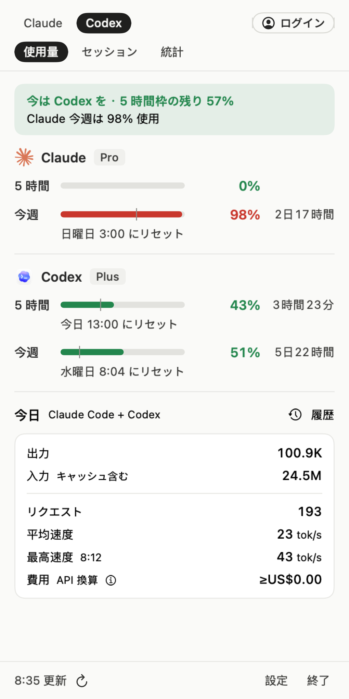

# Quotlet

**Claude Code・Codex・Gemini の使用枠とリアルタイム速度（tok/s）を macOS メニューバーに表示します。**

[English](README.md) | [简体中文](README.zh-CN.md) | [繁體中文](README.zh-TW.md) | 日本語 | [한국어](README.ko.md)

> **Quotlet は 0.4.1 まで Quotabar という名前でした。** それらのバージョンのファイル名は `Quotabar.app` / `Quotabar-<バージョン>.dmg` のままです。GitHub リポジトリは `tluo-github/quotabar` から `tluo-github/quotlet` に移り、古いリンクは自動で転送されます。

Quotlet は **Claude Code**、**Codex**、**Antigravity（Gemini）** のトークン、セッション、リアルタイム出力速度（tok/s）、API 換算費用を既定でローカルログ・ローカルサービスから集計します。Codex の使用枠はローカルログから、Gemini の使用枠は `127.0.0.1` の Antigravity ローカルサービスから取得（オフラインキャッシュ対応）。設定で Claude の使用枠 API を有効にすると、`/usage` と同じ 5 時間・週間の枠も取得できます。「履歴」をクリックすると詳しい推移を確認できます。

<p>
  
  
</p>


> Quotlet は独立したオープンソースプロジェクトであり、Anthropic・OpenAI・Google とは関係ありません。Claude・Codex・Gemini は各社の商標です。

## 機能

- **メニューバーでひと目で確認**：パネル上部や設定から Claude・Codex・Gemini の表示対象をすぐ切り替えられます。`5h 41% 週 62%`（コンパクトな `41% 62%` も選択可）を表示します。
- **全ローカル AI のリアルタイム tok/s**：パネル上部の速度メーターと 1 / 2 / 5 分グラフで Claude・Codex・Gemini の並列出力速度を合算表示し、提供元ごとの速度とピークを確認できます。
- **3 つの提供元を並べて表示**：Claude（任意 API）、Codex（ローカルログ）、Gemini（Antigravity ローカルサービス＋キャッシュ）の 5 時間・週間・モデル別使用枠をリセット時刻と残り時間つきで一覧表示。Claude の API 更新間隔中は新規ローカルトークンから推定（`≈`）して次の応答で補正し、いずれかが上限間近なら余裕のある提供元への切り替えを提案します。
- **今日**：今日の Claude Code・Codex・Gemini の出力・入力トークン、リクエスト数、平均・ピーク速度（tok/s）、API 換算の費用。
- **使用量の履歴ウィンドウ**：ソースと期間（今日、昨日、7/30/90 日、今年、すべて）で絞り込み。3 サービス積み上げグラフと平均速度の線、プロジェクト推移・モデル別内訳、セッション一覧（右クリックで再開コマンドをコピー）、CSV 書き出しに対応。日ごとの合計は Mac に残ります。
- **通知**：既定でオンです。Claude・Codex・Gemini の使用率が 90%（80%・95% も選択可）、100%、リセット後に通知します。Claude の推定値も対象です。macOS の通知を許可してください。
- **任意の Quotlet Cloud**：GitHub でログインすると、[app.quotlet.com](https://app.quotlet.com) の Web やスマートフォンで Claude・Codex・Gemini の上限、セッション、分析、ページ内アラートを確認できます。ログインしなければ無効のままです。
- **5 言語対応**：English、简体中文、繁體中文、日本語、한국어。システムに合わせるか設定で選べます。外観はライト・ダーク・自動。
- 更新間隔の設定と HTTP プロキシに対応し、Anthropic に接続できないときはプロキシ設定を案内します。

## 動作環境

- macOS 13 Ventura 以降（Apple シリコン / Intel）
- Claude Code・Codex・Antigravity（Gemini）のいずれかのローカルログ（Claude サブスクリプション枠の取得には Claude Pro / Max でのログインが必要）

## インストール

### AI にインストールを頼む

Mac でコマンドを実行できる AI アシスタントに送ってください。

> この Mac に Quotlet をインストールしてください。https://quotlet.com の公式手順と https://github.com/tluo-github/quotlet の公式リリースを使ってください。macOS 13 以降であることを確認し、Homebrew または署名・公証済みのパッケージでインストールして、Quotlet を起動してください。

### ダウンロード

[Releases](https://github.com/tluo-github/quotlet/releases/latest) からお使いのチップに合わせて **Quotlet-<バージョン>-arm64.dmg**（Apple シリコン）または **Quotlet-<バージョン>-x86_64.dmg**（Intel）をダウンロードして開き、**Quotlet** を「アプリケーション」にドラッグします。Apple の署名と公証済みなので、ダブルクリックで開けます。

### Homebrew

```bash
brew tap tluo-github/quotlet https://github.com/tluo-github/quotlet
brew trust tluo-github/quotlet
brew install --cask quotlet
```

アップデートは `brew upgrade --cask quotlet`、削除は `brew uninstall --cask quotlet` です。

### インストール後

- メニューバーに数字が見当たらない場合は、隠れた領域に入っている可能性があります。**Command** キーを押しながら好きな位置へドラッグすると、macOS がその位置を記憶します。
- Antigravity CLI（`agy`）だけでも使えます。Antigravity アプリがなくても CLI を検出し、`~/.gemini/antigravity-cli/brain` からセッション、最新モデル、トークン使用量を表示します。
- 同じ Quotlet Cloud アカウントの複数の Mac で使用枠を共有します。ある Mac で使用枠を読めない場合（`agy` だけの Mac など）、他の Mac が報告した最新の 5 時間・週間の使用枠を Mac 名つきで表示し、全 Mac の今日の合計も表示します（同じセッションは 1 回だけ集計）。
- 設定（パネルの右下）で言語、外観、メニューバーの表示、更新間隔、ログイン時の起動、プロキシ、通知を変更できます。

## しくみ

| 内容 | 取得元 |
|---|---|
| Claude の上限とリセット時刻 | `api.anthropic.com/api/oauth/usage`（任意・既定オフ） |
| Claude のセッションとトークン | `~/.claude/projects` にある Claude Code のローカルログ |
| Codex の上限、セッション、トークン | `~/.codex/sessions` にある Codex のローカルログ（Codex が Claude Code から取り込んだセッションは除外） |
| Gemini の上限、セッション、トークン | `127.0.0.1` の Antigravity ローカルサービス（IDE と CLI それぞれの `daemon/hub_*.json`、ローカルキャッシュ対応）と `~/.gemini/antigravity/brain`・`~/.gemini/antigravity-cli/brain` の読み取り専用ログ |

- Quotlet は、Claude Code がキーチェーンに保存しているログイン情報（`Claude Code-credentials`）をシステムの `security` コマンドで読み取ります。ログイン情報を更新・変更することはなく、Quotlet Cloud にログインしない限り、ネットワーク通信は Anthropic への使用量の問い合わせだけです。Cloud にログインすると、上限、トークン数、セッションの状態（プロンプトやコードは含みません）も app.quotlet.com に送ります。
- Claude Code のログインは数時間ごとに期限が切れ、次に Claude Code を使ったときに自動で更新されます。Quotlet に期限切れと表示されたら、Claude Code で何かメッセージを送ってください。Quotlet は 1 分ごとに再試行し、その間は前回のデータを表示し続けます。
- トークン統計では、1 つの返信を 1 回だけ数えます。Claude Code は 1 つの返信の使用量を複数のログ行に書き込みます。`/stats` はすべての行を数えているようで、合計が約 2 倍になります。
- 速度は、出力トークン ÷ 返信にかかった時間（リクエストから返信の完了まで）です。費用は各モデルの公式 API 価格で見積もった「API で支払った場合の金額」で、定額プランでは実際にはかかりません。価格不明のモデル（Codex のモデルなど）は含みません。
- セッションと統計はこの Mac の分だけです。claude.ai、モバイル、他のコンピュータでの使用も上限には含まれますが、セッション一覧には表示されません。

> 使用量のエンドポイントは公開ドキュメントがありません。Anthropic が仕様を変えた場合、Quotlet の更新が必要になることがあります。

## 更新とプロキシ

- Claude の使用枠 API は設定で有効にでき、既定で 10 分ごとに更新します（設定で 1〜30 分）。Anthropic はこのエンドポイントのレート制限を公開していません。頻繁すぎると制限（HTTP 429）される場合があり、その際 Quotlet は 5 分待ってから再試行します。セッションと統計はローカルログの変更を監視し、毎分の補助スキャンも行います。推定には同じ枠内の少なくとも二つの有効な API 応答が必要です。
- Anthropic に接続できないときは、パネルにプロキシ設定へのボタン付きの案内が出ます。**HTTP プロキシを使う** をオンにしてホストとポートを入力してください。

## ソースからビルド

Xcode Command Line Tools（`xcode-select --install`）が必要です。サードパーティの依存はありません。

```bash
git clone https://github.com/tluo-github/quotlet.git && cd quotlet
./build.sh            # この Mac 用に build/Quotlet.app を作成
./build.sh install    # ビルドして「アプリケーション」にコピーし起動
./build.sh release    # Apple シリコン / Intel 個別ビルド：dist/Quotlet-<バージョン>-{arm64,x86_64}.{dmg,zip}
```

開発用コマンドとコード構成は [English README](README.md#build-from-source) を参照してください。

## ライセンス

[MIT](LICENSE)
