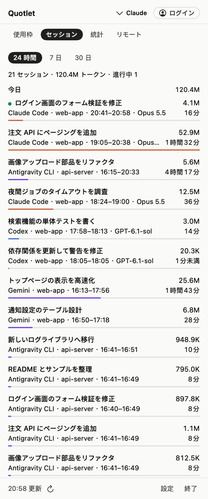
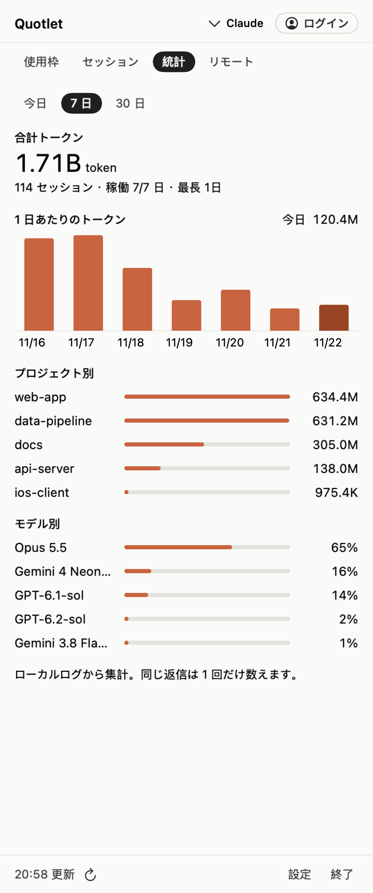
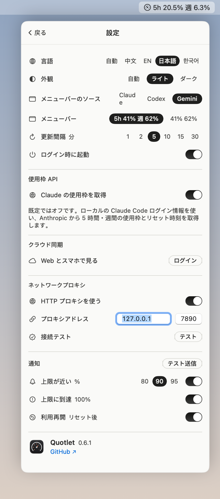

# Quotlet

**Claude プランの使用量を macOS のメニューバーに表示します。**

[English](README.md) | [简体中文](README.zh-CN.md) | 日本語 | [한국어](README.ko.md)

> **Quotlet は 0.4.1 まで Quotabar という名前でした。** それらのバージョンのファイル名は `Quotabar.app` / `Quotabar-<バージョン>.dmg` のままです。GitHub リポジトリは `tluo-github/quotabar` から `tluo-github/quotlet` に移り、古いリンクは自動で転送されます。

Quotlet は Claude Code の `/usage` と同じ数値を表示します。5 時間のセッション枠と週間上限をどれだけ使ったか、それぞれいつリセットされるかがひと目でわかります。クリックすると詳細、最近の Claude Code セッション、トークン統計を確認できます。

<a href="docs/demo-ja.mp4"></a>

<sub>アニメーションをクリックすると MP4 動画を再生できます。</sub>

<p>
  
  
  
  
</p>

> Quotlet は独立したオープンソースプロジェクトです。Anthropic が開発・提携・公認したものではありません。「Claude」は Anthropic の商標です。

## 機能

- **メニューバーでひと目で確認**：`5h 41% 週 62%`（`41% 62%` だけの表示も可能）のように、5 時間枠と週間上限の使用率を表示します。
- **使用量**：プランのすべての上限（5 時間セッション、週間、Fable などモデル別の週間上限）を、リセット時刻、残り時間、経過時間の目盛りとともに表示します。正常時は緑、上限に近づくと琥珀色・赤になり、プラン名の横に状態バッジが出ます。
- **通知**：上限が近いとき（80%・90%・95% から選択）、上限に達したとき、リセットされて再び使えるようになったときにお知らせします。
- **セッション**：過去 24 時間 / 7 日 / 30 日の Claude Code セッションを表示し、どれが多く使ったかを棒で示します。右クリックで `claude --resume` コマンドをコピーできます。
- **統計**：合計トークン、1 日ごとのトークン、プロジェクト別のトークン。
- **4 言語対応**：English、简体中文、日本語、한국어。システムに合わせるか設定で選べます。外観はライト・ダーク・自動。
- 更新間隔の設定と HTTP プロキシに対応し、Anthropic に接続できないときはプロキシ設定を案内します。

## 動作環境

- macOS 14 Sonoma 以降（Apple シリコン / Intel）
- [Claude Code](https://docs.claude.com/en/docs/claude-code) がインストールされ、Claude Pro または Max プランでログインしていること

## インストール

### ダウンロード

[Releases](https://github.com/tluo-github/quotlet/releases/latest) から **Quotlet-<バージョン>.dmg** をダウンロードして開き、**Quotlet** を「アプリケーション」にドラッグします。Apple の署名と公証済みなので、ダブルクリックで開けます。

### Homebrew

```bash
brew tap tluo-github/quotlet https://github.com/tluo-github/quotlet
brew trust tluo-github/quotlet
brew install --cask quotlet
```

アップデートは `brew upgrade --cask quotlet`、削除は `brew uninstall --cask quotlet` です。

### インストール後

- メニューバーに数字が見当たらない場合は、隠れた領域に入っている可能性があります。**Command** キーを押しながら好きな位置へドラッグすると、macOS がその位置を記憶します。
- 設定（左下の歯車アイコン）で言語、外観、メニューバーの表示、更新間隔、ログイン時の起動、プロキシ、通知を変更できます。

## しくみ

| 内容 | 取得元 |
|---|---|
| 上限とリセット時刻 | `api.anthropic.com/api/oauth/usage`（`/usage` と同じエンドポイント） |
| セッションとトークン | `~/.claude/projects` にある Claude Code のローカルログ |

- Quotlet は、Claude Code がキーチェーンに保存しているログイン情報（`Claude Code-credentials`）をシステムの `security` コマンドで読み取ります。ログイン情報を更新・変更することはなく、ネットワーク通信は Anthropic への使用量の問い合わせだけです。
- Claude Code のログインは数時間ごとに期限が切れ、次に Claude Code を使ったときに自動で更新されます。Quotlet に期限切れと表示されたら、Claude Code で何かメッセージを送ってください。Quotlet は 1 分ごとに再試行し、その間は前回のデータを表示し続けます。
- トークン統計では、1 つの返信を 1 回だけ数えます。Claude Code は 1 つの返信の使用量を複数のログ行に書き込みます。`/stats` はすべての行を数えているようで、合計が約 2 倍になります。
- セッションと統計はこの Mac の分だけです。claude.ai、モバイル、他のコンピュータでの使用も上限には含まれますが、セッション一覧には表示されません。

> 使用量のエンドポイントは公開ドキュメントがありません。Anthropic が仕様を変えた場合、Quotlet の更新が必要になることがあります。

## 更新とプロキシ

- 上限は既定で 5 分ごとに更新します（設定で 1〜30 分）。Anthropic はこのエンドポイントのレート制限を公開していません。頻繁すぎると制限（HTTP 429）される場合があり、その際 Quotlet は 5 分待ってから再試行します。セッションと統計はローカルログを毎分読み込みます。
- Anthropic に接続できないときは、使用量タブにプロキシ設定へのボタン付きの案内が出ます。**HTTP プロキシを使う** をオンにしてホストとポートを入力してください。

## ソースからビルド

Xcode Command Line Tools（`xcode-select --install`）が必要です。サードパーティの依存はありません。

```bash
git clone https://github.com/tluo-github/quotlet.git && cd quotlet
./build.sh            # この Mac 用に build/Quotlet.app を作成
./build.sh install    # ビルドして「アプリケーション」にコピーし起動
./build.sh release    # ユニバーサルビルド：dist/Quotlet-<バージョン>.dmg と .zip
```

開発用コマンドとコード構成は [English README](README.md#build-from-source) を参照してください。

## ライセンス

[MIT](LICENSE)
