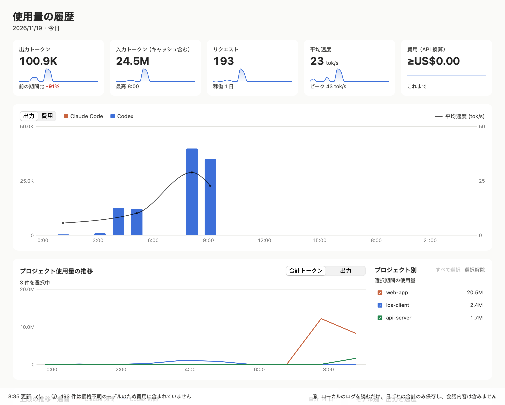

# Quotlet

**Claude プランの使用量を macOS のメニューバーに表示します。**

[English](README.md) | [简体中文](README.zh-CN.md) | 日本語 | [한국어](README.ko.md)

> **Quotlet は 0.4.1 まで Quotabar という名前でした。** それらのバージョンのファイル名は `Quotabar.app` / `Quotabar-<バージョン>.dmg` のままです。GitHub リポジトリは `tluo-github/quotabar` から `tluo-github/quotlet` に移り、古いリンクは自動で転送されます。

Quotlet は Claude Code と Codex のローカルログからトークン、セッション、速度を集計します。Claude の使用枠 API を設定で有効にすると、`/usage` と同じ使用枠も取得できます。5 時間のセッション枠と週間上限をどれだけ使ったか、それぞれいつリセットされるかがひと目でわかります。Codex も使っているなら、その上限がすぐ下に並びます。「履歴」をクリックすると、セッション、日ごとのトークン、速度、API 換算の費用を大きなウィンドウで確認できます。

<p>
  
  
</p>



> Quotlet は独立したオープンソースプロジェクトです。Anthropic が開発・提携・公認したものではありません。「Claude」は Anthropic の商標です。

## 機能

- **メニューバーでひと目で確認**：`5h 41% 週 62%`（`41% 62%` だけの表示も可能）のように、Claude の 5 時間枠と週間上限の使用率を表示します。
- **パネルは上限だけ**：Claude のすべての上限（5 時間、週間、モデル別の週間）と、Codex を使っていればその 5 時間・週間上限を 1 行ずつ、リセット時刻と残り時間つきで表示します。Claude の API 更新間隔中は、ローカルの新規トークンから推定した使用率を ≈ で表示し、次の API 応答で補正します。片方が上限間近でもう片方に余裕があるときは、切り替えを提案します。
- **今日**：今日の Claude Code と Codex の出力・入力トークン、リクエスト数、平均・ピーク速度（tok/s）、API 換算の費用。
- **使用量の履歴ウィンドウ**：ソースと期間（今日、昨日、7/30/90 日、今年、すべて）で絞り込み。概要カード、日ごとの出力・費用グラフと平均速度の線、週間上限の推移、プロジェクト別・モデル別の内訳、セッション一覧（右クリックで再開コマンドをコピー）。CSV で書き出せます。日ごとの合計はローカルに保存されるので、Claude Code が 30 日でログを消しても履歴は残ります。
- **通知**：既定でオンです。Claude と Codex の使用率が 90%（80%・95% も選択可）、100%、リセット後に通知します。Claude の推定値も通知に使い、推定であることを明示します。各通知は枠ごとに一度だけです。macOS の通知を許可してください。
- **任意の Quotlet Cloud**：GitHub でログインすると、[app.quotlet.com](https://app.quotlet.com) の Web やスマートフォンで上限とセッションを確認できます。ログインしなければ無効のままです。
- **4 言語対応**：English、简体中文、日本語、한국어。システムに合わせるか設定で選べます。外観はライト・ダーク・自動。
- 更新間隔の設定と HTTP プロキシに対応し、Anthropic に接続できないときはプロキシ設定を案内します。

## 動作環境

- macOS 14 Sonoma 以降（Apple シリコン / Intel）
- [Claude Code](https://docs.claude.com/en/docs/claude-code) がインストールされ、Claude Pro または Max プランでログインしていること

## インストール

### ダウンロード

[Releases](https://github.com/tluo-github/quotlet/releases/latest) から **Quotlet-<バージョン>.dmg** をダウンロードして開き、**Quotlet** を「アプリケーション」にドラッグします。Apple の署名と公証済みなので、ダブルクリックで開けます。

### Homebrew

```bash
brew tap tluo-github/quotlet https://github.com/tluo-github/quotlet
brew trust tluo-github/quotlet
brew install --cask quotlet
```

アップデートは `brew upgrade --cask quotlet`、削除は `brew uninstall --cask quotlet` です。

### インストール後

- メニューバーに数字が見当たらない場合は、隠れた領域に入っている可能性があります。**Command** キーを押しながら好きな位置へドラッグすると、macOS がその位置を記憶します。
- 設定（パネルの右下）で言語、外観、メニューバーの表示、更新間隔、ログイン時の起動、プロキシ、通知を変更できます。

## しくみ

| 内容 | 取得元 |
|---|---|
| 上限とリセット時刻 | `api.anthropic.com/api/oauth/usage`（`/usage` と同じエンドポイント） |
| セッションとトークン | `~/.claude/projects` にある Claude Code のローカルログ |
| Codex の上限、セッション、トークン | `~/.codex/sessions` にある Codex のローカルログ（Codex が Claude Code から取り込んだセッションは除外） |

- Quotlet は、Claude Code がキーチェーンに保存しているログイン情報（`Claude Code-credentials`）をシステムの `security` コマンドで読み取ります。ログイン情報を更新・変更することはなく、Quotlet Cloud にログインしない限り、ネットワーク通信は Anthropic への使用量の問い合わせだけです。Cloud にログインすると、上限、トークン数、セッションの状態（プロンプトやコードは含みません）も app.quotlet.com に送ります。
- Claude Code のログインは数時間ごとに期限が切れ、次に Claude Code を使ったときに自動で更新されます。Quotlet に期限切れと表示されたら、Claude Code で何かメッセージを送ってください。Quotlet は 1 分ごとに再試行し、その間は前回のデータを表示し続けます。
- トークン統計では、1 つの返信を 1 回だけ数えます。Claude Code は 1 つの返信の使用量を複数のログ行に書き込みます。`/stats` はすべての行を数えているようで、合計が約 2 倍になります。
- 速度は、出力トークン ÷ 返信にかかった時間（リクエストから返信の完了まで）です。費用は各モデルの公式 API 価格で見積もった「API で支払った場合の金額」で、定額プランでは実際にはかかりません。価格不明のモデル（Codex のモデルなど）は含みません。
- セッションと統計はこの Mac の分だけです。claude.ai、モバイル、他のコンピュータでの使用も上限には含まれますが、セッション一覧には表示されません。

> 使用量のエンドポイントは公開ドキュメントがありません。Anthropic が仕様を変えた場合、Quotlet の更新が必要になることがあります。

## 更新とプロキシ

- Claude の使用枠 API は設定で有効にでき、既定で 10 分ごとに更新します（設定で 1〜30 分）。Anthropic はこのエンドポイントのレート制限を公開していません。頻繁すぎると制限（HTTP 429）される場合があり、その際 Quotlet は 5 分待ってから再試行します。セッションと統計はローカルログの変更を監視し、毎分の補助スキャンも行います。推定には同じ枠内の少なくとも二つの有効な API 応答が必要です。
- Anthropic に接続できないときは、パネルにプロキシ設定へのボタン付きの案内が出ます。**HTTP プロキシを使う** をオンにしてホストとポートを入力してください。

## ソースからビルド

Xcode Command Line Tools（`xcode-select --install`）が必要です。サードパーティの依存はありません。

```bash
git clone https://github.com/tluo-github/quotlet.git && cd quotlet
./build.sh            # この Mac 用に build/Quotlet.app を作成
./build.sh install    # ビルドして「アプリケーション」にコピーし起動
./build.sh release    # ユニバーサルビルド：dist/Quotlet-<バージョン>.dmg と .zip
```

開発用コマンドとコード構成は [English README](README.md#build-from-source) を参照してください。

## ライセンス

[MIT](LICENSE)
