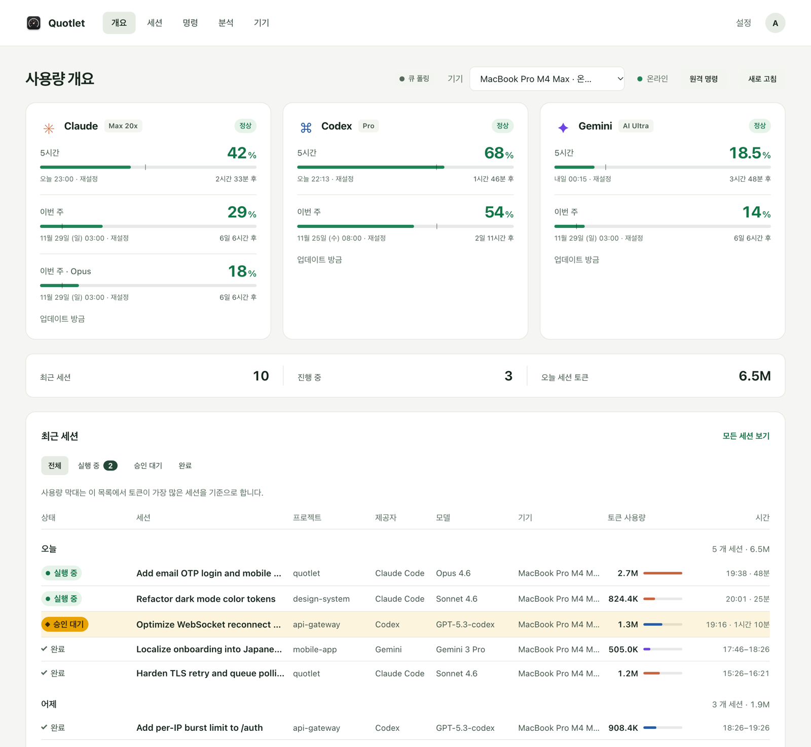
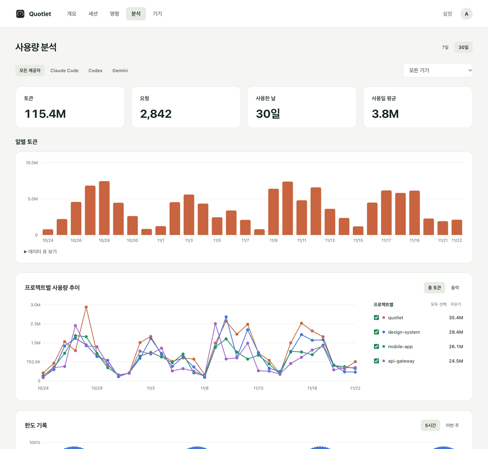
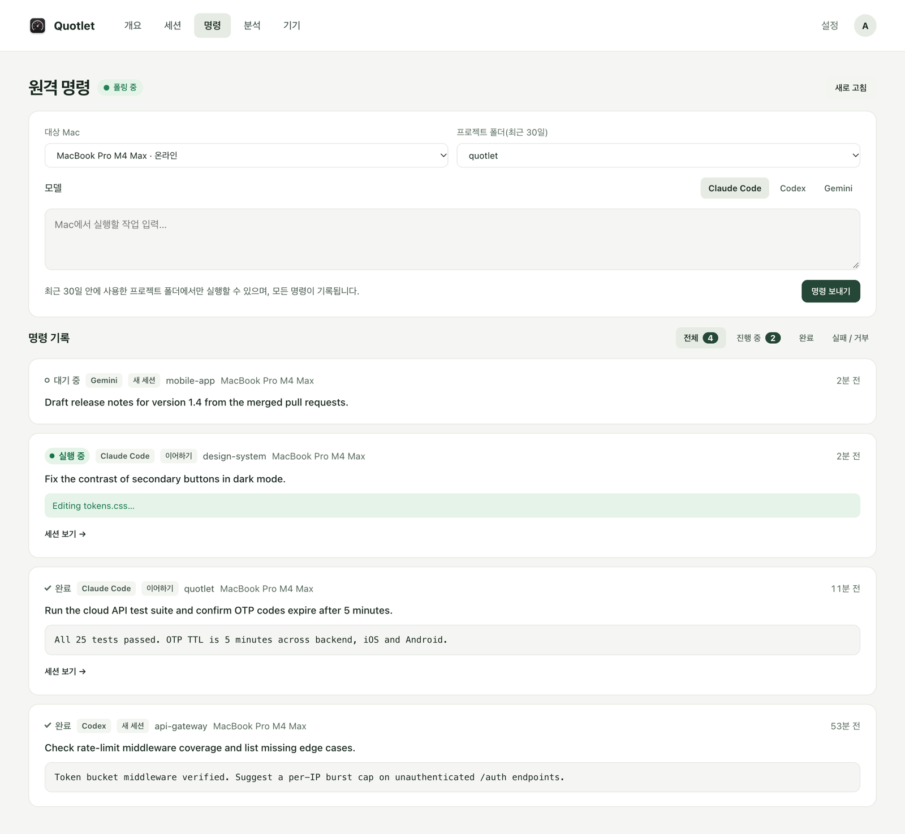
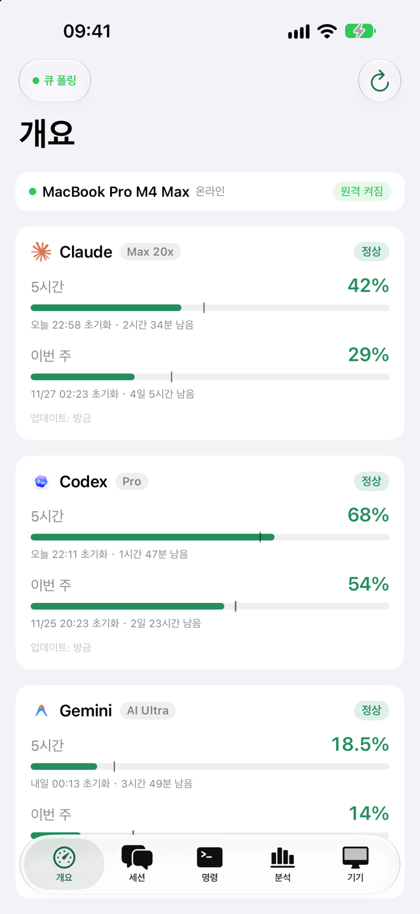
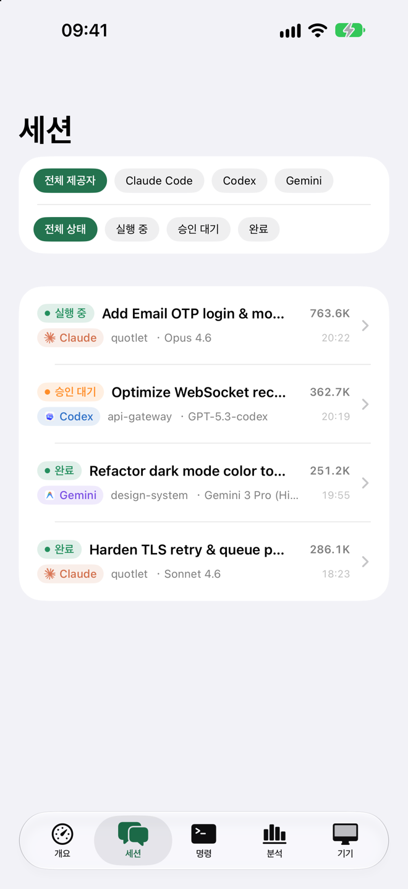
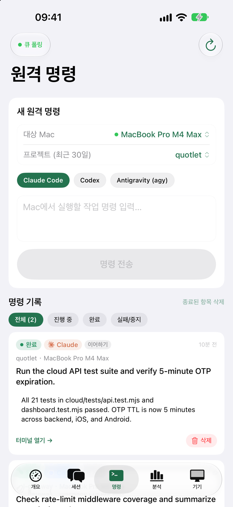

# Quotlet

**Claude Code, Codex, Gemini 한도와 실시간 속도(tok/s)를 macOS 메뉴 막대에 표시합니다.**

[English](README.md) | [简体中文](README.zh-CN.md) | [繁體中文](README.zh-TW.md) | [日本語](README.ja.md) | 한국어

> **Quotlet은 0.4.1까지 Quotabar라는 이름이었습니다.** 해당 버전의 파일 이름은 `Quotabar.app` / `Quotabar-<버전>.dmg` 그대로입니다. GitHub 저장소는 `tluo-github/quotabar`에서 `tluo-github/quotlet`으로 바뀌었고, 예전 링크는 자동으로 연결됩니다.

Quotlet는 **Claude Code**, **Codex**, **Antigravity(Gemini)**의 토큰, 세션, 실시간 출력 속도(tok/s), API 환산 비용을 기본으로 로컬 로그와 로컬 서비스에서 집계합니다. Codex 한도는 로컬 로그에서, Gemini 한도는 `127.0.0.1`의 Antigravity 로컬 서비스에서 조회(오프라인 캐시 지원)하며, 설정에서 Claude 한도 API를 켜면 `/usage`와 같은 5시간·주간 한도도 조회합니다. **기록**을 클릭하면 자세한 추이를 볼 수 있습니다.

<p>
  
  
</p>


> Quotlet은 독립적인 오픈 소스 프로젝트로, Anthropic, OpenAI, Google과 관련이 없습니다. Claude, Codex, Gemini는 각 소유자의 상표입니다.

## 기능

- **메뉴 막대에서 한눈에**: 패널 상단과 설정에서 Claude, Codex, Gemini 중 메뉴 막대에 표시할 소스를 바로 전환할 수 있습니다. `5h 41% 주 62%`(간단한 `41% 62%`도 선택 가능) 형식을 지원합니다.
- **모든 로컬 AI의 실시간 tok/s**: 패널 상단의 속도계와 1분 / 2분 / 5분 차트로 Claude, Codex, Gemini의 동시 출력을 합산해 보여 주며, 제공자별 실시간 속도와 최고 속도를 확인합니다.
- **세 제공자를 나란히**: Claude(선택적 API), Codex(로컬 로그), Gemini(Antigravity 로컬 서비스+캐시)의 5시간·주간·모델별 한도를 재설정 시각 및 남은 시간과 함께 표시합니다. Claude API 업데이트 사이에는 새 로컬 토큰으로 추정(`≈`)해 다음 응답으로 보정하며, 한쪽이 한도에 가까워지면 여유 있는 다른 제공자로 전환을 제안합니다.
- **오늘**: 오늘 Claude Code, Codex, Gemini의 출력·입력 토큰, 요청 수, 평균·최고 속도(tok/s), API 환산 비용.
- **사용량 기록 창**: 소스와 기간(오늘, 어제, 7/30/90일, 올해, 전체)으로 필터링. 세 제공자 누적 차트와 평균 속도 선, 프로젝트·모델별 추이, 세션 표(오른쪽 클릭으로 재개 명령 복사), CSV 내보내기를 지원하며 일별 합계는 Mac에 남습니다.
- **알림**: 기본으로 켜져 있습니다. Claude, Codex, Gemini의 사용률이 90%(80%·95% 선택 가능), 100%, 재설정 후에 알립니다. Claude 추정값도 포함됩니다. macOS 알림 권한을 허용하세요.
- **선택 사항인 Quotlet Cloud**: GitHub 또는 이메일 인증 코드로 로그인하면 웹 대시보드와 iPhone 앱에서 한도, 세션, 분석을 확인하고 Mac에 원격 명령도 보낼 수 있습니다(아래 참고). 로그인하지 않으면 꺼져 있습니다.
- **5개 언어 지원**: English, 简体中文, 繁體中文, 日本語, 한국어. 시스템 언어를 따르거나 설정에서 고를 수 있습니다. 화면 모드는 라이트·다크·자동.
- 새로 고침 주기 설정과 HTTP 프록시를 지원하며, Anthropic에 연결할 수 없으면 프록시 설정을 안내합니다.

## Quotlet Cloud: 웹 대시보드와 iPhone 앱

선택 기능입니다. Mac 앱에서 GitHub 또는 이메일 인증 코드로 로그인하면 한도, 토큰 수, 세션 상태가 Quotlet Cloud에 동기화되어 Mac 앞에 없어도 확인할 수 있습니다. 프롬프트와 코드는 Mac 밖으로 나가지 않으며, 로그인하지 않으면 아무것도 동기화되지 않습니다.

- **웹 대시보드**([app.quotlet.com](https://app.quotlet.com)): Mac별 Claude, Codex, Gemini 한도, 실시간 세션 상태(실행 중, 승인 대기, 완료), 제공자·프로젝트·모델별 사용량 분석, 최근 90일 한도 기록, 페이지 내 알림, 기기 관리. 5개 언어와 라이트·다크 테마를 지원합니다.
- **원격 명령**: 브라우저나 휴대폰에서 Mac의 Claude Code, Codex, Antigravity에 명령을 보내 새 세션을 시작하거나 기존 세션을 이어 갈 수 있습니다. 기본적으로 꺼져 있으며 해당 Mac의 Quotlet 설정에서 켭니다. 최근 30일 안에 사용한 프로젝트에서만 실행되고 모든 명령이 기록됩니다.
- **iPhone 앱**(App Store 출시 예정): 개요, 세션, 원격 명령, 분석, 기기 관리를 네이티브 앱으로 제공합니다. Android 버전도 개발 중입니다.



<p>
  
  
</p>

<p>
  
  
  
</p>

## 요구 사항

- macOS 13 Ventura 이상(Apple 실리콘 / Intel)
- Claude Code, Codex 또는 Antigravity(Gemini)의 로컬 로그(Claude 구독 한도 조회에는 Claude Pro / Max 로그인 필요)

## 설치

### AI에게 설치 부탁하기

Mac에서 명령을 실행할 수 있는 AI 도우미에게 보내세요.

> 이 Mac에 Quotlet을 설치해 주세요. https://quotlet.com 의 공식 안내와 https://github.com/tluo-github/quotlet 의 공식 릴리스를 사용하세요. macOS 13 이상인지 확인하고 Homebrew 또는 서명 및 공증된 패키지로 설치한 다음 Quotlet을 실행해 주세요.

### 다운로드

[Releases](https://github.com/tluo-github/quotlet/releases/latest)에서 칩에 맞게 **Quotlet-<버전>-arm64.dmg**(Apple 실리콘) 또는 **Quotlet-<버전>-x86_64.dmg**(Intel)를 내려받아 열고 **Quotlet**를 '응용 프로그램'으로 드래그하세요. Apple 서명과 공증을 거쳤으므로 더블 클릭으로 바로 열립니다.

### Homebrew

```bash
brew tap tluo-github/quotlet https://github.com/tluo-github/quotlet
brew trust tluo-github/quotlet
brew install --cask quotlet
```

업데이트는 `brew upgrade --cask quotlet`, 삭제는 `brew uninstall --cask quotlet`입니다.

### 설치 후

- 메뉴 막대에 숫자가 보이지 않으면 숨겨진 영역에 들어갔을 수 있습니다. **Command** 키를 누른 채 원하는 위치로 드래그하면 macOS가 위치를 기억합니다.
- Antigravity CLI(`agy`)만 설치해도 사용할 수 있습니다. Antigravity 앱 없이 CLI를 감지해 `~/.gemini/antigravity-cli/brain`에서 세션, 최근 모델, 토큰 사용량을 표시합니다.
- 같은 Quotlet Cloud 계정의 여러 Mac이 한도를 공유합니다. 어떤 Mac에서 한도를 읽을 수 없으면(`agy`만 설치된 Mac 등) 다른 Mac이 보고한 최신 5시간·주간 한도를 Mac 이름과 함께 표시하고, 모든 Mac의 오늘 합계도 보여 줍니다(같은 세션은 한 번만 계산).
- 설정(패널 오른쪽 아래)에서 언어, 화면 모드, 메뉴 막대 표시, 새로 고침 주기, 로그인 시 실행, 프록시, 알림을 바꿀 수 있습니다.

## 작동 방식

| 항목 | 출처 |
|---|---|
| Claude 한도와 재설정 시각 | `api.anthropic.com/api/oauth/usage`(선택 사항, 기본 꺼짐) |
| Claude 세션과 토큰 | `~/.claude/projects`에 있는 Claude Code 로컬 로그 |
| Codex 한도, 세션, 토큰 | `~/.codex/sessions`에 있는 Codex 로컬 로그(Codex가 Claude Code에서 가져온 세션은 제외) |
| Gemini 한도, 세션, 토큰 | `127.0.0.1`의 Antigravity 로컬 서비스(IDE와 CLI 각각의 `daemon/hub_*.json`, 로컬 캐시 지원)와 `~/.gemini/antigravity/brain`·`~/.gemini/antigravity-cli/brain` 읽기 전용 로그 |

- Quotlet는 Claude Code가 키체인에 저장한 로그인 정보(`Claude Code-credentials`)를 시스템의 `security` 명령으로 읽습니다. 로그인 정보를 갱신하거나 바꾸지 않으며, Quotlet Cloud에 로그인하지 않으면 네트워크 요청은 Anthropic에 사용량을 조회하는 것뿐입니다. Cloud에 로그인하면 한도, 토큰 수, 세션 상태(프롬프트와 코드는 제외)도 app.quotlet.com으로 보냅니다.
- Claude Code 로그인은 몇 시간마다 만료되고, 다음에 Claude Code를 사용할 때 자동으로 갱신됩니다. Quotlet에 로그인 만료가 표시되면 Claude Code에서 아무 메시지나 보내세요. Quotlet는 1분마다 다시 시도하며 그동안 이전 데이터를 계속 보여 줍니다.
- 토큰 통계는 응답 하나를 한 번만 셉니다. Claude Code는 응답 하나의 사용량을 여러 로그 줄에 기록하는데, `/stats`는 모든 줄을 세는 것으로 보여 합계가 약 두 배로 나옵니다.
- 속도는 출력 토큰 ÷ 응답에 걸린 시간(요청부터 응답 완료까지)입니다. 비용은 각 모델의 공식 API 가격으로 추정한 'API로 결제했다면 드는 금액'이며, 구독 요금제는 실제로 이만큼 청구되지 않습니다. 가격을 알 수 없는 모델(예: Codex 모델)은 포함하지 않습니다.
- 세션과 통계는 이 Mac만 포함합니다. claude.ai, 모바일, 다른 컴퓨터에서의 사용도 한도에는 포함되지만 세션 목록에는 나오지 않습니다.

> 사용량 엔드포인트는 공개 문서가 없습니다. Anthropic이 변경하면 Quotlet 업데이트가 필요할 수 있습니다.

## 새로 고침과 프록시

- Claude 한도 API는 설정에서 켤 수 있으며 기본 10분마다 새로 고칩니다(설정에서 1~30분). Anthropic은 이 엔드포인트의 호출 제한을 공개하지 않습니다. 너무 자주 새로 고치면 제한(HTTP 429)될 수 있으며, 그때 Quotlet는 5분 기다린 뒤 다시 시도합니다. 세션과 통계는 로컬 로그 변경을 감지하고 매분 보조 스캔도 수행합니다. 추정에는 같은 구간의 유효한 API 응답이 최소 두 번 필요합니다.
- Anthropic에 연결할 수 없으면 패널에 프록시 설정 버튼이 있는 안내가 표시됩니다. **HTTP 프록시 사용**을 켜고 호스트와 포트를 입력하세요.

## 소스에서 빌드

Xcode Command Line Tools(`xcode-select --install`)가 필요합니다. 서드파티 의존성은 없습니다.

```bash
git clone https://github.com/tluo-github/quotlet.git && cd quotlet
./build.sh            # 이 Mac용 build/Quotlet.app 생성
./build.sh install    # 빌드 후 '응용 프로그램'에 복사하고 실행
./build.sh release    # Apple 실리콘 / Intel 개별 빌드: dist/Quotlet-<버전>-{arm64,x86_64}.{dmg,zip}
```

개발용 명령과 코드 구성은 [English README](README.md#build-from-source)를 참고하세요.

## 라이선스

[MIT](LICENSE)
