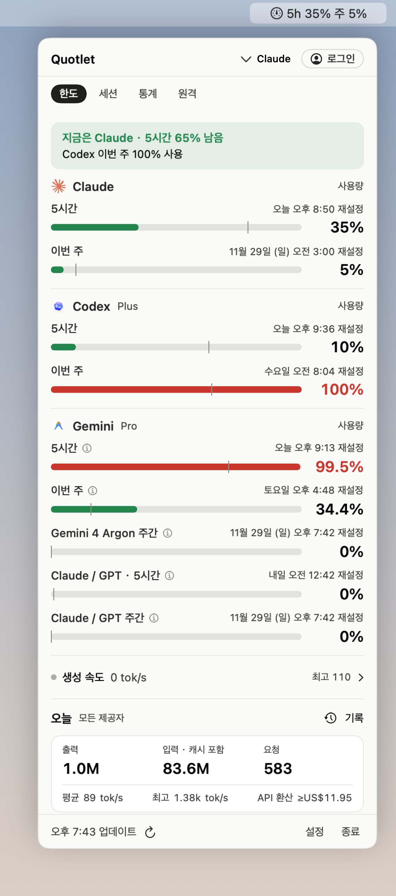
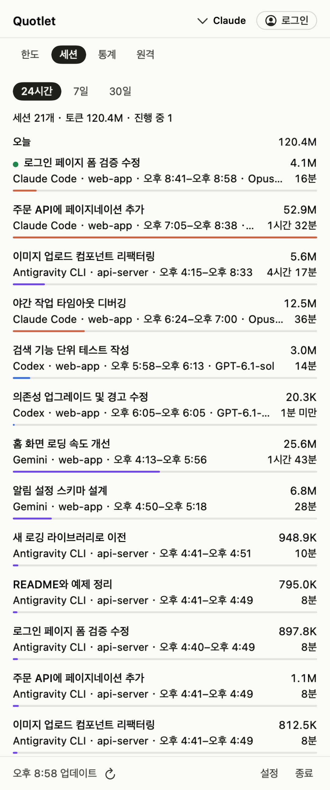
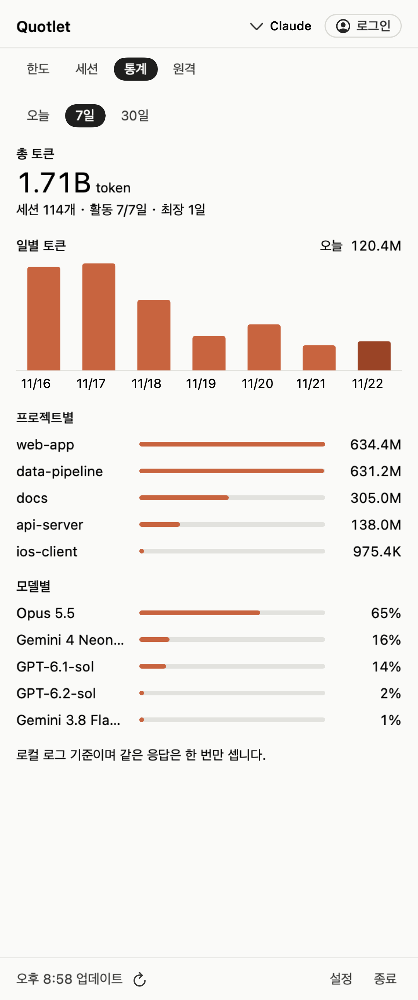
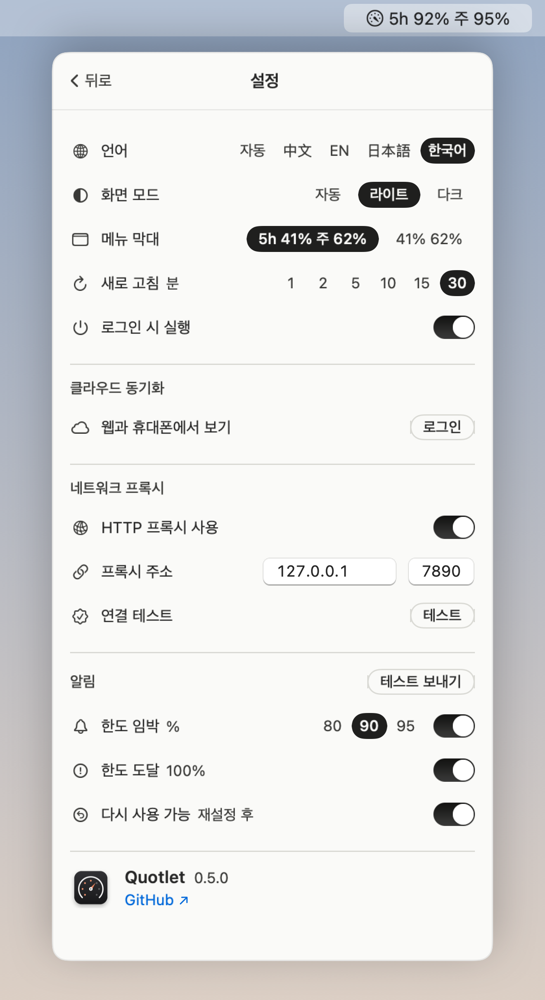

# Quotlet

**Claude 요금제 사용량을 macOS 메뉴 막대에 표시합니다.**

[English](README.md) | [简体中文](README.zh-CN.md) | [日本語](README.ja.md) | 한국어

> **Quotlet은 0.4.1까지 Quotabar라는 이름이었습니다.** 해당 버전의 파일 이름은 `Quotabar.app` / `Quotabar-<버전>.dmg` 그대로입니다. GitHub 저장소는 `tluo-github/quotabar`에서 `tluo-github/quotlet`으로 바뀌었고, 예전 링크는 자동으로 연결됩니다.

Quotlet는 Claude Code의 `/usage`와 같은 수치를 보여 줍니다. 5시간 세션 구간과 주간 한도를 얼마나 썼는지, 각각 언제 재설정되는지 한눈에 확인할 수 있습니다. 클릭하면 자세한 내용, 최근 Claude Code 세션, 토큰 통계를 볼 수 있습니다.

<a href="docs/demo-ko.mp4"></a>

<sub>애니메이션을 클릭하면 MP4 동영상을 볼 수 있습니다.</sub>

<p>
  
  
  
  
</p>

> Quotlet는 독립적인 오픈 소스 프로젝트입니다. Anthropic이 만들거나 제휴하거나 보증한 제품이 아닙니다. "Claude"는 Anthropic의 상표입니다.

## 기능

- **메뉴 막대에서 한눈에**: `5h 41% 주 62%`(또는 `41% 62%`만)처럼 5시간 구간과 주간 한도의 사용률을 표시합니다.
- **사용량**: 요금제의 모든 한도(5시간 세션, 주간, Fable 같은 모델별 주간 한도)를 재설정 시각, 남은 시간, 경과 시간 눈금과 함께 보여 줍니다. 정상일 때 초록색, 한도에 가까워지면 호박색과 빨간색으로 바뀌고 요금제 이름 옆에 상태 배지가 표시됩니다.
- **알림**: 한도에 가까워질 때(80%·90%·95% 중 선택), 한도에 도달했을 때, 재설정되어 다시 사용할 수 있을 때 알려 줍니다.
- **세션**: 최근 24시간 / 7일 / 30일의 Claude Code 세션을 보여 주고, 어떤 세션이 많이 썼는지 막대로 표시합니다. 오른쪽 클릭으로 `claude --resume` 명령을 복사할 수 있습니다.
- **통계**: 총 토큰, 일별 토큰, 프로젝트별 토큰.
- **4개 언어 지원**: English, 简体中文, 日本語, 한국어. 시스템 언어를 따르거나 설정에서 고를 수 있습니다. 화면 모드는 라이트·다크·자동.
- 새로 고침 주기 설정과 HTTP 프록시를 지원하며, Anthropic에 연결할 수 없으면 프록시 설정을 안내합니다.

## 요구 사항

- macOS 14 Sonoma 이상(Apple 실리콘 / Intel)
- [Claude Code](https://docs.claude.com/en/docs/claude-code)가 설치되어 있고 Claude Pro 또는 Max 요금제로 로그인되어 있어야 합니다

## 설치

### 다운로드

[Releases](https://github.com/tluo-github/quotlet/releases/latest)에서 **Quotlet-<버전>.dmg**를 내려받아 열고 **Quotlet**를 '응용 프로그램'으로 드래그하세요. Apple 서명과 공증을 거쳤으므로 더블 클릭으로 바로 열립니다.

### Homebrew

```bash
brew tap tluo-github/quotlet https://github.com/tluo-github/quotlet
brew install --cask quotlet
```

업데이트는 `brew upgrade --cask quotlet`, 삭제는 `brew uninstall --cask quotlet`입니다.

### 설치 후

- 메뉴 막대에 숫자가 보이지 않으면 숨겨진 영역에 들어갔을 수 있습니다. **Command** 키를 누른 채 원하는 위치로 드래그하면 macOS가 위치를 기억합니다.
- 설정(왼쪽 아래 톱니바퀴 아이콘)에서 언어, 화면 모드, 메뉴 막대 표시, 새로 고침 주기, 로그인 시 실행, 프록시, 알림을 바꿀 수 있습니다.

## 작동 방식

| 항목 | 출처 |
|---|---|
| 한도와 재설정 시각 | `api.anthropic.com/api/oauth/usage`(`/usage`가 쓰는 엔드포인트) |
| 세션과 토큰 | `~/.claude/projects`에 있는 Claude Code 로컬 로그 |

- Quotlet는 Claude Code가 키체인에 저장한 로그인 정보(`Claude Code-credentials`)를 시스템의 `security` 명령으로 읽습니다. 로그인 정보를 갱신하거나 바꾸지 않으며, 네트워크 요청은 Anthropic에 사용량을 조회하는 것뿐입니다.
- Claude Code 로그인은 몇 시간마다 만료되고, 다음에 Claude Code를 사용할 때 자동으로 갱신됩니다. Quotlet에 로그인 만료가 표시되면 Claude Code에서 아무 메시지나 보내세요. Quotlet는 1분마다 다시 시도하며 그동안 이전 데이터를 계속 보여 줍니다.
- 토큰 통계는 응답 하나를 한 번만 셉니다. Claude Code는 응답 하나의 사용량을 여러 로그 줄에 기록하는데, `/stats`는 모든 줄을 세는 것으로 보여 합계가 약 두 배로 나옵니다.
- 세션과 통계는 이 Mac만 포함합니다. claude.ai, 모바일, 다른 컴퓨터에서의 사용도 한도에는 포함되지만 세션 목록에는 나오지 않습니다.

> 사용량 엔드포인트는 공개 문서가 없습니다. Anthropic이 변경하면 Quotlet 업데이트가 필요할 수 있습니다.

## 새로 고침과 프록시

- 한도는 기본 5분마다 새로 고칩니다(설정에서 1~30분). Anthropic은 이 엔드포인트의 호출 제한을 공개하지 않습니다. 너무 자주 새로 고치면 제한(HTTP 429)될 수 있으며, 그때 Quotlet는 5분 기다린 뒤 다시 시도합니다. 세션과 통계는 로컬 로그를 매분 읽습니다.
- Anthropic에 연결할 수 없으면 사용량 탭에 프록시 설정 버튼이 있는 안내가 표시됩니다. **HTTP 프록시 사용**을 켜고 호스트와 포트를 입력하세요.

## 소스에서 빌드

Xcode Command Line Tools(`xcode-select --install`)가 필요합니다. 서드파티 의존성은 없습니다.

```bash
git clone https://github.com/tluo-github/quotlet.git && cd quotlet
./build.sh            # 이 Mac용 build/Quotlet.app 생성
./build.sh install    # 빌드 후 '응용 프로그램'에 복사하고 실행
./build.sh release    # 유니버설 빌드: dist/Quotlet-<버전>.dmg 및 .zip
```

개발용 명령과 코드 구성은 [English README](README.md#build-from-source)를 참고하세요.

## 라이선스

[MIT](LICENSE)
