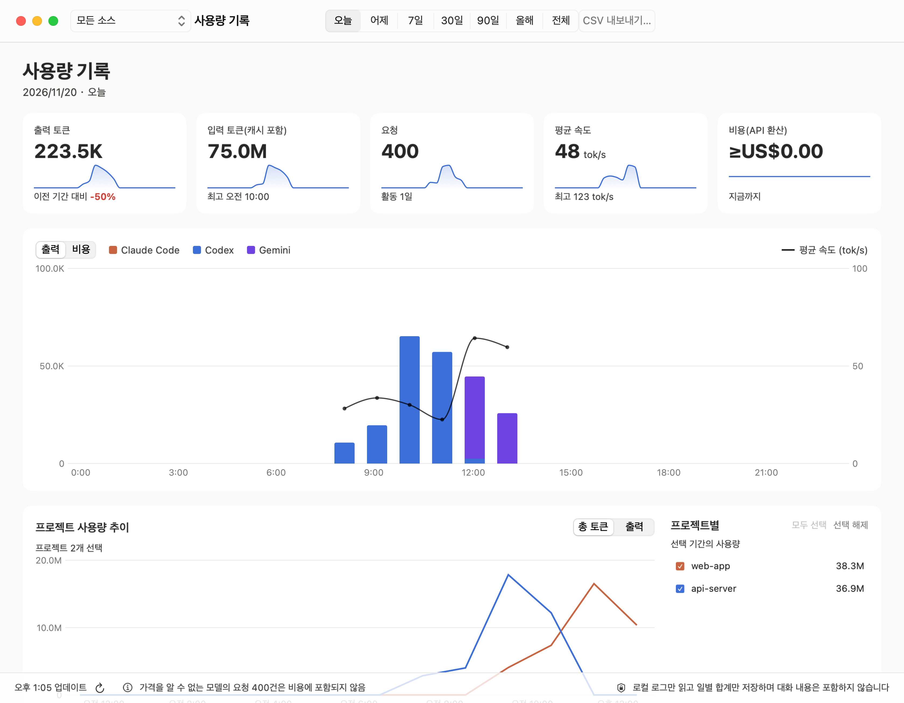

# Quotlet

**Claude 요금제 사용량을 macOS 메뉴 막대에 표시합니다.**

[English](README.md) | [简体中文](README.zh-CN.md) | [日本語](README.ja.md) | 한국어

> **Quotlet은 0.4.1까지 Quotabar라는 이름이었습니다.** 해당 버전의 파일 이름은 `Quotabar.app` / `Quotabar-<버전>.dmg` 그대로입니다. GitHub 저장소는 `tluo-github/quotabar`에서 `tluo-github/quotlet`으로 바뀌었고, 예전 링크는 자동으로 연결됩니다.

Quotlet는 Claude Code와 Codex의 로컬 로그에서 토큰, 세션, 속도를 집계합니다. 설정에서 Claude 한도 API를 켜면 `/usage`와 같은 한도도 조회합니다. 5시간 세션 구간과 주간 한도를 얼마나 썼는지, 각각 언제 재설정되는지 한눈에 확인할 수 있습니다. Codex도 쓴다면 그 한도가 바로 아래에 표시됩니다. **기록**을 클릭하면 세션, 일별 토큰, 속도, API 환산 비용을 큰 창에서 볼 수 있습니다.

<p>
  
  
</p>



> Quotlet는 독립적인 오픈 소스 프로젝트입니다. Anthropic이 만들거나 제휴하거나 보증한 제품이 아닙니다. "Claude"는 Anthropic의 상표입니다.

## 기능

- **메뉴 막대에서 한눈에**: `5h 41% 주 62%`(또는 `41% 62%`만)처럼 Claude 5시간 구간과 주간 한도의 사용률을 표시합니다.
- **패널은 한도만**: Claude의 모든 한도(5시간, 주간, 모델별 주간)와, Codex를 쓴다면 그 5시간·주간 한도를 한 줄씩 재설정 시각과 남은 시간과 함께 보여 줍니다. Claude API 업데이트 사이에는 새 로컬 토큰으로 추정한 사용률을 ≈로 표시하고 다음 API 응답으로 보정합니다. 한쪽이 거의 소진되고 다른 쪽에 여유가 있으면 전환을 제안합니다.
- **오늘**: 오늘 Claude Code와 Codex의 출력·입력 토큰, 요청 수, 평균·최고 속도(tok/s), API 환산 비용.
- **사용량 기록 창**: 소스와 기간(오늘, 어제, 7/30/90일, 올해, 전체)으로 걸러 보고, 요약 카드, 일별 출력·비용 차트와 평균 속도 선, 주간 한도 추이, 프로젝트·모델별 비중, 세션 표(오른쪽 클릭으로 재개 명령 복사)를 제공합니다. CSV로 내보낼 수 있습니다. 일별 합계는 로컬에 저장되어 Claude Code가 30일 뒤 로그를 지워도 기록이 남습니다.
- **알림**: 기본으로 켜져 있습니다. Claude와 Codex의 사용률이 90%(80%·95% 선택 가능), 100%, 재설정 후에 알립니다. Claude 추정값도 알림을 트리거하며 추정임을 표시합니다. 각 알림은 한도 구간마다 한 번 전송됩니다. macOS 알림 권한을 허용하세요.
- **선택 사항인 Quotlet Cloud**: GitHub로 로그인하면 [app.quotlet.com](https://app.quotlet.com)의 웹과 휴대폰에서 한도와 세션을 볼 수 있습니다. 로그인하지 않으면 꺼져 있습니다.
- **4개 언어 지원**: English, 简体中文, 日本語, 한국어. 시스템 언어를 따르거나 설정에서 고를 수 있습니다. 화면 모드는 라이트·다크·자동.
- 새로 고침 주기 설정과 HTTP 프록시를 지원하며, Anthropic에 연결할 수 없으면 프록시 설정을 안내합니다.

## 요구 사항

- macOS 14 Sonoma 이상(Apple 실리콘 / Intel)
- [Claude Code](https://docs.claude.com/en/docs/claude-code)가 설치되어 있고 Claude Pro 또는 Max 요금제로 로그인되어 있어야 합니다

## 설치

### AI에게 설치 부탁하기

Mac에서 명령을 실행할 수 있는 AI 도우미에게 보내세요.

> 이 Mac에 Quotlet을 설치해 주세요. https://quotlet.com 의 공식 안내와 https://github.com/tluo-github/quotlet 의 공식 릴리스를 사용하세요. macOS 14 이상인지 확인하고 Homebrew 또는 서명 및 공증된 패키지로 설치한 다음 Quotlet을 실행해 주세요.

### 다운로드

[Releases](https://github.com/tluo-github/quotlet/releases/latest)에서 **Quotlet-<버전>.dmg**를 내려받아 열고 **Quotlet**를 '응용 프로그램'으로 드래그하세요. Apple 서명과 공증을 거쳤으므로 더블 클릭으로 바로 열립니다.

### Homebrew

```bash
brew tap tluo-github/quotlet https://github.com/tluo-github/quotlet
brew trust tluo-github/quotlet
brew install --cask quotlet
```

업데이트는 `brew upgrade --cask quotlet`, 삭제는 `brew uninstall --cask quotlet`입니다.

### 설치 후

- 메뉴 막대에 숫자가 보이지 않으면 숨겨진 영역에 들어갔을 수 있습니다. **Command** 키를 누른 채 원하는 위치로 드래그하면 macOS가 위치를 기억합니다.
- 설정(패널 오른쪽 아래)에서 언어, 화면 모드, 메뉴 막대 표시, 새로 고침 주기, 로그인 시 실행, 프록시, 알림을 바꿀 수 있습니다.

## 작동 방식

| 항목 | 출처 |
|---|---|
| 한도와 재설정 시각 | `api.anthropic.com/api/oauth/usage`(`/usage`가 쓰는 엔드포인트) |
| 세션과 토큰 | `~/.claude/projects`에 있는 Claude Code 로컬 로그 |
| Codex 한도, 세션, 토큰 | `~/.codex/sessions`에 있는 Codex 로컬 로그(Codex가 Claude Code에서 가져온 세션은 제외) |

- Quotlet는 Claude Code가 키체인에 저장한 로그인 정보(`Claude Code-credentials`)를 시스템의 `security` 명령으로 읽습니다. 로그인 정보를 갱신하거나 바꾸지 않으며, Quotlet Cloud에 로그인하지 않으면 네트워크 요청은 Anthropic에 사용량을 조회하는 것뿐입니다. Cloud에 로그인하면 한도, 토큰 수, 세션 상태(프롬프트와 코드는 제외)도 app.quotlet.com으로 보냅니다.
- Claude Code 로그인은 몇 시간마다 만료되고, 다음에 Claude Code를 사용할 때 자동으로 갱신됩니다. Quotlet에 로그인 만료가 표시되면 Claude Code에서 아무 메시지나 보내세요. Quotlet는 1분마다 다시 시도하며 그동안 이전 데이터를 계속 보여 줍니다.
- 토큰 통계는 응답 하나를 한 번만 셉니다. Claude Code는 응답 하나의 사용량을 여러 로그 줄에 기록하는데, `/stats`는 모든 줄을 세는 것으로 보여 합계가 약 두 배로 나옵니다.
- 속도는 출력 토큰 ÷ 응답에 걸린 시간(요청부터 응답 완료까지)입니다. 비용은 각 모델의 공식 API 가격으로 추정한 'API로 결제했다면 드는 금액'이며, 구독 요금제는 실제로 이만큼 청구되지 않습니다. 가격을 알 수 없는 모델(예: Codex 모델)은 포함하지 않습니다.
- 세션과 통계는 이 Mac만 포함합니다. claude.ai, 모바일, 다른 컴퓨터에서의 사용도 한도에는 포함되지만 세션 목록에는 나오지 않습니다.

> 사용량 엔드포인트는 공개 문서가 없습니다. Anthropic이 변경하면 Quotlet 업데이트가 필요할 수 있습니다.

## 새로 고침과 프록시

- Claude 한도 API는 설정에서 켤 수 있으며 기본 10분마다 새로 고칩니다(설정에서 1~30분). Anthropic은 이 엔드포인트의 호출 제한을 공개하지 않습니다. 너무 자주 새로 고치면 제한(HTTP 429)될 수 있으며, 그때 Quotlet는 5분 기다린 뒤 다시 시도합니다. 세션과 통계는 로컬 로그 변경을 감지하고 매분 보조 스캔도 수행합니다. 추정에는 같은 구간의 유효한 API 응답이 최소 두 번 필요합니다.
- Anthropic에 연결할 수 없으면 패널에 프록시 설정 버튼이 있는 안내가 표시됩니다. **HTTP 프록시 사용**을 켜고 호스트와 포트를 입력하세요.

## 소스에서 빌드

Xcode Command Line Tools(`xcode-select --install`)가 필요합니다. 서드파티 의존성은 없습니다.

```bash
git clone https://github.com/tluo-github/quotlet.git && cd quotlet
./build.sh            # 이 Mac용 build/Quotlet.app 생성
./build.sh install    # 빌드 후 '응용 프로그램'에 복사하고 실행
./build.sh release    # 유니버설 빌드: dist/Quotlet-<버전>.dmg 및 .zip
```

개발용 명령과 코드 구성은 [English README](README.md#build-from-source)를 참고하세요.

## 라이선스

[MIT](LICENSE)
