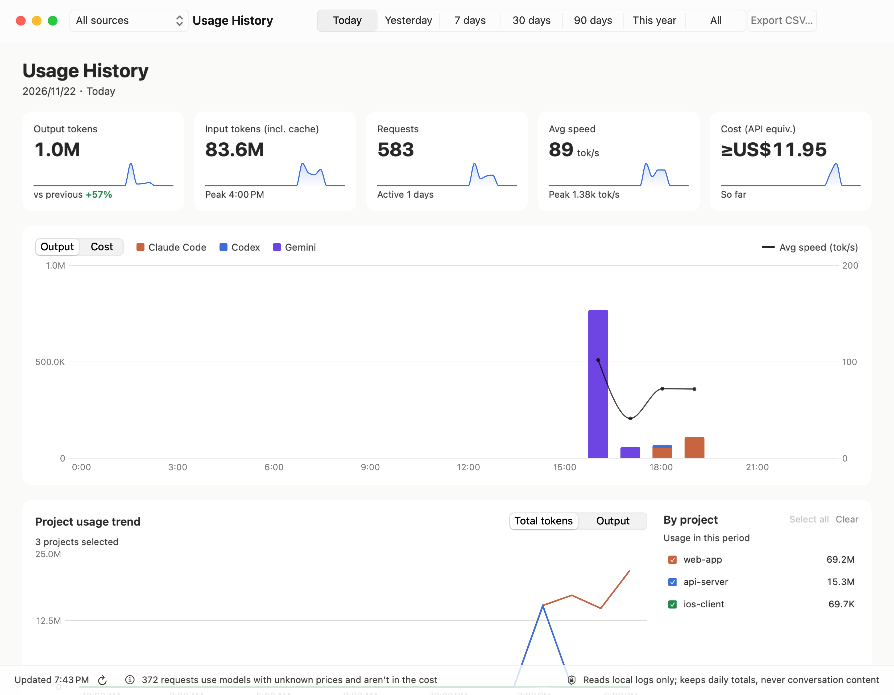

# Quotlet

**Claude Code and Codex usage in the macOS menu bar.**

English | [简体中文](README.zh-CN.md) | [日本語](README.ja.md) | [한국어](README.ko.md)

> **Quotlet was called Quotabar up to version 0.4.1.** Those releases are still named `Quotabar.app` / `Quotabar-<version>.dmg`. The GitHub repo moved from `tluo-github/quotabar` to `tluo-github/quotlet`; old links redirect.

Quotlet defaults to local logs for Claude Code and Codex tokens, sessions, speed and API-equivalent cost, without reading login credentials. Codex limits also come from local logs. Enable the optional Claude quota API in Settings to fetch the same 5-hour and weekly limits as `/usage`. Click **History** for detailed trends.

<p>
  
  
</p>



> Quotlet is an independent open-source project. It is not made by, affiliated with, or endorsed by Anthropic. "Claude" is a trademark of Anthropic.

## Features

- **Menu bar at a glance**: today's tokens in Claude local mode; `5h 41% Wk 62%` (or just `41% 62%`) for Codex or Claude with the quota API enabled.
- **Optional quota lookup**: enable the Claude quota API for 5-hour, weekly and per-model limits. Codex limits come directly from local logs. Each limit shows its reset time and countdown.
- **Switch suggestion**: when one provider reaches your warning threshold and the other has room, the usage tab recommends switching.
- **Today**: output and input tokens, requests, average and peak speed (tok/s) and the API-equivalent cost of today's Claude Code and Codex use.
- **Quick sessions and stats**: switch tabs in the menu-bar panel to see recent local sessions or 7/30-day summaries without opening History.
- **Usage history window**: filter by source and range (today, yesterday, 7/30/90 days, this year, all). Project trends select all projects by default; toggle projects to compare lines, hover for values, and switch between total and output tokens. The window also shows daily output, cost and speed, weekly limits, model breakdowns, and a session table with resume commands. Export to CSV. Daily totals stay on your Mac after Claude Code clears old logs.
- **Quota notifications**: enabled by default at 90% (80% or 95% also available), at 100%, and after a reset. Both Claude and Codex are covered. Claude estimates can trigger alerts between API refreshes, with an estimate label and one alert of each kind per window. Allow macOS notifications when prompted.
- **Optional Quotlet Cloud**: sign in with GitHub to see your limits and sessions at [app.quotlet.com](https://app.quotlet.com), on the web or your phone. Off until you sign in.
- **Four languages**: English, 简体中文, 日本語 and 한국어. Follows your system language or pick one in Settings. Light, dark or automatic appearance.
- Configurable refresh interval and an optional HTTP proxy, with a hint when Anthropic can't be reached.

## Requirements

- macOS 14 Sonoma or later, Apple silicon or Intel
- Local Claude Code or Codex session logs; fetching Claude subscription limits additionally requires Claude Code signed in with a Pro or Max plan

## Install

### Ask your AI to install

Copy the following into an AI assistant that can run commands on your Mac.

> Please install Quotlet on this Mac. Use the official instructions at https://quotlet.com and releases from https://github.com/tluo-github/quotlet. Confirm macOS 14 or later, install with Homebrew or the signed and notarized package, then launch Quotlet.

### Download

Download **Quotlet-<version>.dmg** from [Releases](https://github.com/tluo-github/quotlet/releases/latest), open it and drag **Quotlet** into **Applications**. The app is signed and notarized by Apple, so it opens with a double-click.

### Homebrew

```bash
brew tap tluo-github/quotlet https://github.com/tluo-github/quotlet
brew trust tluo-github/quotlet
brew install --cask quotlet
```

Update with `brew upgrade --cask quotlet`, remove with `brew uninstall --cask quotlet`.

### After installing

- The default mode reads local Claude Code and Codex logs for token stats. To fetch Claude quota, enable **Settings → Quota API → Fetch Claude quota**. If macOS requires permission, click **Allow Keychain Access** in that same section. Notifications are on by default and require macOS permission. Existing explicit preferences are preserved.
- If the numbers don't show up in the menu bar, macOS may have tucked them into the hidden part of the menu bar. Hold **Command** and drag them where you want; macOS remembers the position.
- Settings (bottom right of the panel): language, appearance, menu bar style, refresh interval, launch at login, proxy and notifications.

## How it works

| What | Source |
|---|---|
| Limits and reset times | `api.anthropic.com/api/oauth/usage`, the endpoint `/usage` uses |
| Sessions and tokens | Claude Code's local logs in `~/.claude/projects` |
| Codex limits, sessions and tokens | Codex's local logs in `~/.codex/sessions` (sessions Codex imported from Claude Code are skipped) |

- Enabling the Claude quota API lets Quotlet read Claude Code's Keychain login (`Claude Code-credentials`, with local credential-file fallback) and contact Anthropic for quota data. Only the **Allow Keychain Access** button can trigger the macOS prompt for Claude credentials. Quotlet Cloud is a separate optional sign-in: it sends limits, token counts and session status (never prompts or code) to app.quotlet.com. Restoring a Cloud session at startup cannot show a Keychain prompt.
- Claude Code logins expire every few hours and Claude Code renews them the next time you use it. If Quotlet says your login expired, send any message in Claude Code. Quotlet retries every minute and keeps showing the last data meanwhile.
- Token stats count each reply once. Claude Code writes the same usage on several log lines per reply; `/stats` appears to count every line, so its totals run about twice as high.
- Speed is output tokens ÷ the time a reply took (from the request to the end of the reply). Cost is an estimate at each model's official API prices — what the usage would cost if billed through the API; subscriptions aren't charged this, and models without a known price (such as Codex models) are left out.
- Sessions and stats cover this Mac only. Usage on claude.ai, mobile or other computers counts toward your limits but doesn't appear in the session list.

> The usage endpoint isn't publicly documented. If Anthropic changes it, Quotlet may need an update.

## Refresh and proxy

- Between Claude quota refreshes, the panel and menu bar estimate usage from new local tokens after calibrating against at least two readings in the same quota window. Estimates show `≈` and are corrected by each API response. Model mix, caching and other-device activity affect accuracy. Calibration stays in memory and restarts when the window or plan changes. Estimated usage can trigger quota notifications. Cloud quota history uses API-confirmed values.

- The Claude quota API is off by default. Once enabled, limits refresh every 10 minutes (1 to 30 minutes in Settings). Anthropic doesn't publish a rate limit for this endpoint; very frequent refreshes can get rate limited (HTTP 429), and Quotlet then waits 5 minutes before trying again. Sessions and stats watch local log changes, coalesce nearby writes, and rescan every minute as a fallback. Token counts update when the client writes usage records. Claude credential authentication follows the system and the item's protection settings, which may require the login Keychain password.
- If Anthropic can't be reached, the panel shows a hint with a button to the proxy settings. Turn on **Use HTTP proxy** and enter your proxy's host and port. The proxy is on by default (`127.0.0.1:7890`) when your system language is Chinese or your region is mainland China, Hong Kong or Macau.

## Build from source

Requires the Xcode Command Line Tools (`xcode-select --install`). No third-party dependencies.

```bash
git clone https://github.com/tluo-github/quotlet.git && cd quotlet
./build.sh            # build/Quotlet.app for this Mac
./build.sh install    # build, copy to /Applications and launch
./build.sh release    # universal build: dist/Quotlet-<version>.dmg and .zip
```

Development helpers:

```bash
# Render the panel, settings and history (light and dark) to PNG without touching the menu bar
.build/release/Quotlet --snapshot /tmp/qb -language ja -stage YES -demo YES -scale 3
# Regenerate the README and website screenshots for all four languages
scripts/make-screenshots.sh
# Open the usage history window right after launch
build/Quotlet.app/Contents/MacOS/Quotlet -openHistory YES -demo YES
# A window with the real panel on a clean background, for recording demos
.build/release/Quotlet --showcase -demo YES
# Redraw the app icon
swift scripts/make-icon.swift
```

`-demo YES` replaces session titles and project names with sample text so screenshots don't expose your own projects; `-offline YES` uses the cached usage instead of calling the API; `-scale 3` renders at 3× pixel density.

`./build.sh release` signs with your **Developer ID Application** certificate, notarizes and staples when that certificate is in your keychain (one-time setup: `xcrun notarytool store-credentials quotabar-notary --team-id <TEAM_ID>`); otherwise it builds an ad-hoc signed app.

| File | Purpose |
|---|---|
| `UsageAPI.swift` | Keychain login, usage request, proxy |
| `SessionScanner.swift` | Parses local Claude Code logs |
| `Store.swift` | Refresh schedule, settings, launch at login |
| `Views.swift` | Usage, Sessions, Stats and Settings |
| `Theme.swift` | Colors and type scale |
| `Format.swift` | Languages, dates, durations, token counts |
| `Notifier.swift` | Limit notifications |
| `Snapshot.swift`, `Showcase.swift`, `Demo.swift` | Screenshot, demo-window and sample-data helpers |
| `Casks/quotlet.rb` | Homebrew cask |

## License

[MIT](LICENSE)
