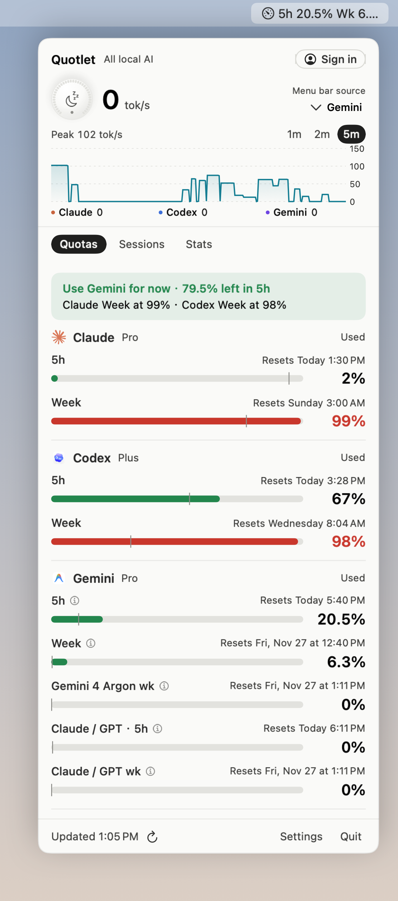
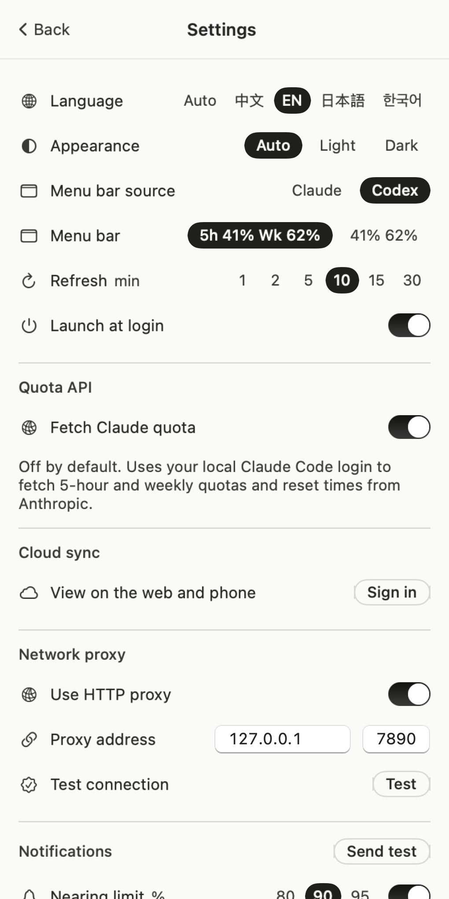
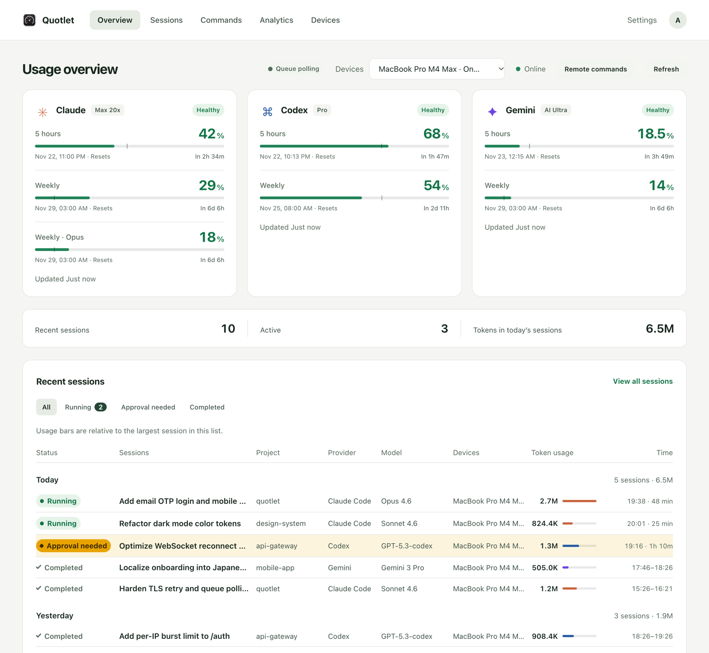
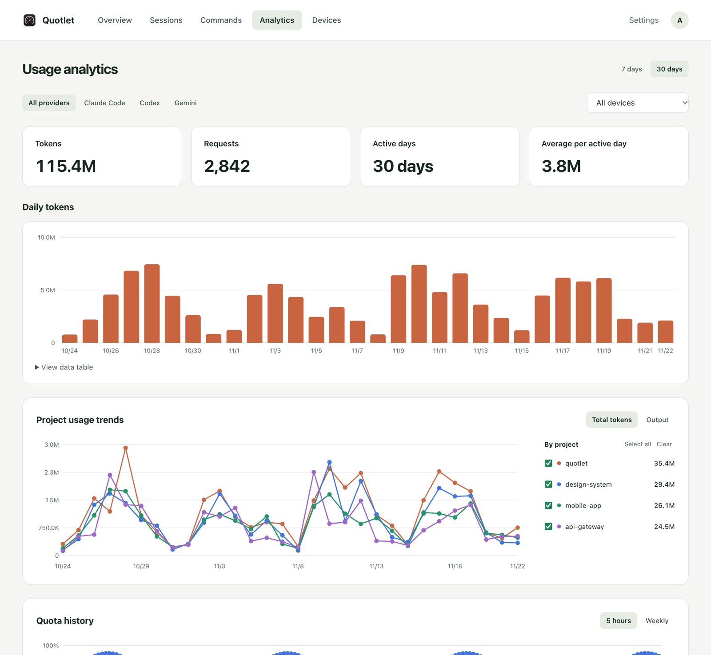
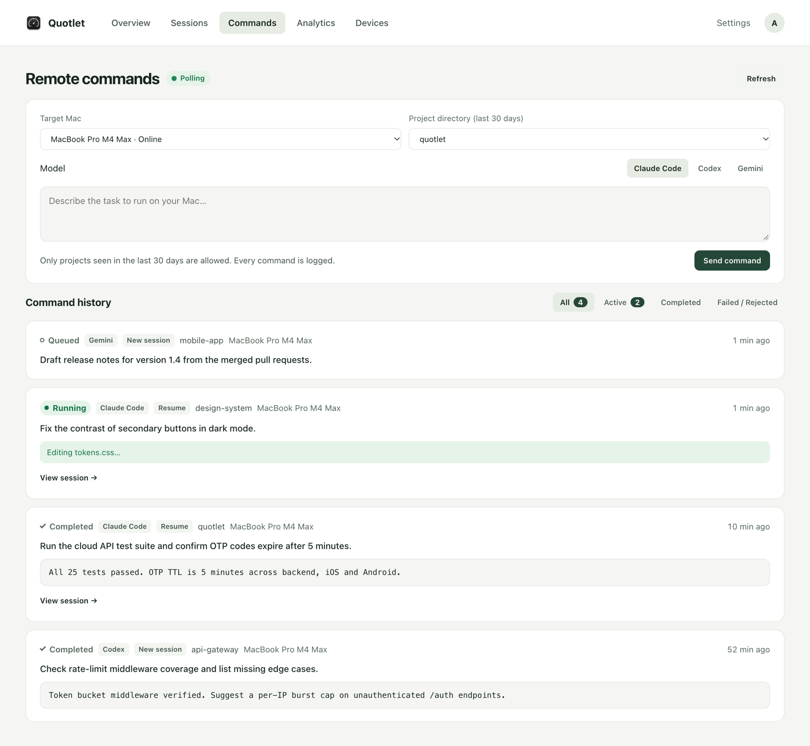
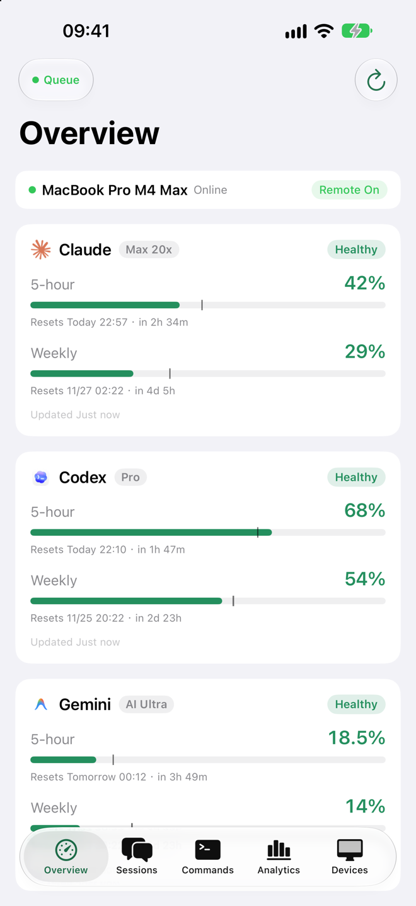
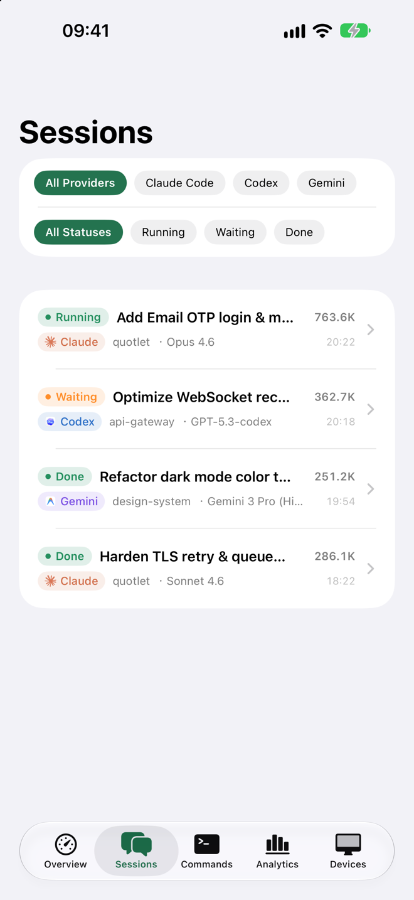
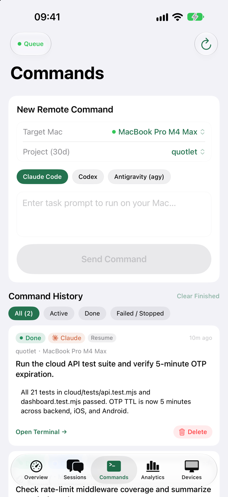

# Quotlet

**Claude Code, Codex and Gemini usage & live tok/s in the macOS menu bar.**

English | [简体中文](README.zh-CN.md) | [繁體中文](README.zh-TW.md) | [日本語](README.ja.md) | [한국어](README.ko.md)

Quotlet tracks **Claude Code**, **Codex** and **Antigravity (Gemini)** tokens, sessions, real-time output throughput (`tok/s`) and API-equivalent cost right from your Mac menu bar — without reading login credentials by default. Codex quotas come from local logs, Gemini quotas from Antigravity's local service (`127.0.0.1`), and optional Claude quota lookup in Settings fetches the same 5-hour and weekly limits as `/usage`. Click **History** for detailed trends.

<p>
  
  
</p>


> Quotlet is an independent open-source project, not affiliated with Anthropic, OpenAI or Google. Claude, Codex and Gemini are trademarks of their respective owners.

## Features

- **Menu bar at a glance**: pick Claude, Codex or Gemini right from the panel header or Settings — `5h 41% Wk 62%` (or compact `41% 62%`), or today's tokens when the Claude quota API is off.
- **Live throughput (`tok/s`)**: real-time speed gauge and 1m / 2m / 5m output chart combining concurrent requests across Claude, Codex and Gemini, with per-provider readings and peak speed.
- **Three providers, side by side**: 5-hour, weekly and model-specific limits for Claude (optional API), Codex (local logs) and Gemini (Antigravity local service with offline cache), each with reset time and countdown.
- **Switch suggestion**: when one provider reaches your warning threshold and another has headroom, a banner recommends switching.
- **Today**: output and input tokens, requests, average and peak speed (`tok/s`) and API-equivalent cost across Claude Code, Codex and Gemini.
- **Quick sessions and stats**: switch between **Quotas**, **Sessions** and **Stats** right inside the menu-bar panel to inspect recent sessions or 7/30-day summaries without opening History.
- **Usage history window**: filter by provider and range (today, yesterday, 7/30/90 days, this year, all). Stacked Claude / Codex / Gemini daily charts with speed line, project trends (toggle projects to compare total or output tokens), weekly limits, model breakdowns, session table with resume commands, and CSV export. Daily totals stay on your Mac after old logs are cleared.
- **Quota notifications**: enabled by default at 90% (80% or 95% also available), at 100%, and after a reset across Claude, Codex and Gemini. Claude local estimates can trigger alerts between API refreshes, with an estimate label and one alert of each kind per window. Allow macOS notifications when prompted.
- **Optional Quotlet Cloud**: sign in with GitHub or an email code to check quotas, sessions and analytics on the web dashboard and the iPhone app, and to send remote commands to your Mac (details below). Off until you sign in.
- **Five languages**: English, 简体中文, 繁體中文, 日本語 and 한국어. Follows your system language or pick one in Settings. Light, dark or automatic appearance.
- Configurable refresh interval and an optional HTTP proxy, with a hint when Anthropic can't be reached.

## Quotlet Cloud: web dashboard and iPhone app

Optional. Sign in from the Mac app with GitHub or an email code, and your quotas, token counts and session status sync to Quotlet Cloud so you can check them away from your Mac. Prompts and code stay on your Mac, and nothing syncs until you sign in.

- **Web dashboard** at [app.quotlet.com](https://app.quotlet.com): Claude, Codex and Gemini quotas for each Mac, live session status (running, waiting for approval, done), usage analytics by provider, project and model, 90 days of quota history, in-page alerts and device management. Five languages, light and dark themes.
- **Remote commands**: from the browser or your phone, send a prompt to Claude Code, Codex or Antigravity on your Mac to start a new session or continue one. Off by default and switched on per Mac in Quotlet's settings; only projects used in the last 30 days are allowed, and every command is logged.
- **iPhone app** (coming soon to the App Store): overview, sessions, remote commands, analytics and devices in a native app. An Android version is also in the works.



<p>
  
  
</p>

<p>
  
  
  
</p>

## Requirements

- macOS 13 Ventura or later, Apple silicon or Intel
- Local Claude Code, Codex or Antigravity (Gemini) logs; fetching Claude subscription limits additionally requires Claude Code signed in with a Pro or Max plan

## Install

### Ask your AI to install

Copy the following into an AI assistant that can run commands on your Mac.

> Please install Quotlet on this Mac. Use the official instructions at https://quotlet.com and releases from https://github.com/tluo-github/quotlet. Confirm macOS 13 or later, install with Homebrew or the signed and notarized package, then launch Quotlet.

### Download

Download **Quotlet-<version>-arm64.dmg** (Apple silicon) or **Quotlet-<version>-x86_64.dmg** (Intel) from [Releases](https://github.com/tluo-github/quotlet/releases/latest), open it and drag **Quotlet** into **Applications**. The app is signed and notarized by Apple, so it opens with a double-click.

### Homebrew

```bash
brew tap tluo-github/quotlet https://github.com/tluo-github/quotlet
brew trust tluo-github/quotlet
brew install --cask quotlet
```

Update with `brew upgrade --cask quotlet`, remove with `brew uninstall --cask quotlet`.

### After installing

- The default mode reads local Claude Code, Codex and Antigravity (Gemini) logs for token stats and throughput, and queries Antigravity's local `127.0.0.1` service for Gemini quotas. To fetch Claude quota, enable **Settings → Quota API → Fetch Claude quota**. If macOS requires permission, click **Allow Keychain Access** in that same section. Notifications are on by default and require macOS permission. Existing explicit preferences are preserved.
- If the numbers don't show up in the menu bar, macOS may have tucked them into the hidden part of the menu bar. Hold **Command** and drag them where you want; macOS remembers the position.
- Works with only the Antigravity CLI (`agy`) installed: no Antigravity app needed. Quotlet detects the CLI and shows its sessions, latest model and token usage from `~/.gemini/antigravity-cli/brain`. Without local quota data it shows "no quota" and keeps counting local usage.
- Several Macs on one Quotlet Cloud account share quota: if one Mac can't read a provider's quota (e.g. a Mac with only `agy`), it shows the newest 5-hour and weekly limits reported by your other Macs, marked with that Mac's name. The panel also shows today's usage across all Macs, counting each session once.
- Settings (bottom right of the panel): language, appearance, menu bar source & style, refresh interval, launch at login, proxy and notifications.

## How it works

| What | Source |
|---|---|
| Claude limits and reset times | `api.anthropic.com/api/oauth/usage` (optional, off by default) |
| Claude sessions and tokens | Claude Code's local logs in `~/.claude/projects` |
| Codex limits, sessions and tokens | Codex's local logs in `~/.codex/sessions` (sessions Codex imported from Claude Code are skipped) |
| Gemini limits, sessions and tokens | Antigravity's local daemon on `127.0.0.1` (`daemon/hub_*.json` under `~/.gemini/antigravity` and `~/.gemini/antigravity-cli`, cached locally) and read-only logs in `~/.gemini/antigravity/brain` and `~/.gemini/antigravity-cli/brain` |

- Enabling the Claude quota API lets Quotlet read Claude Code's Keychain login (`Claude Code-credentials`, with local credential-file fallback) and contact Anthropic for quota data. Only the **Allow Keychain Access** button can trigger the macOS prompt for Claude credentials. Quotlet Cloud is a separate optional sign-in: it sends limits, token counts and session status (never prompts or code) to app.quotlet.com. Restoring a Cloud session at startup cannot show a Keychain prompt.
- Claude Code logins expire every few hours and Claude Code renews them the next time you use it. If Quotlet says your login expired, send any message in Claude Code. Quotlet retries every minute and keeps showing the last data meanwhile.
- Token stats count each reply once. Claude Code writes the same usage on several log lines per reply; `/stats` appears to count every line, so its totals run about twice as high.
- Speed is output tokens ÷ the time a reply took (from the request to the end of the reply). Cost is an estimate at each model's official API prices — what the usage would cost if billed through the API; subscriptions aren't charged this, and models without a known price (such as Codex models) are left out.
- Sessions and stats cover this Mac only. Usage on claude.ai, mobile or other computers counts toward your limits but doesn't appear in the session list.

> The usage endpoint isn't publicly documented. If Anthropic changes it, Quotlet may need an update.

## Refresh and proxy

- Between Claude quota refreshes, the panel and menu bar estimate usage from new local tokens after calibrating against at least two readings in the same quota window. Each API response corrects the estimates. Model mix, caching and other-device activity affect accuracy. Calibration stays in memory and restarts when the window or plan changes. Estimated usage can trigger quota notifications. Cloud quota history uses API-confirmed values.

- The Claude quota API is off by default. Once enabled, limits refresh every 10 minutes (1 to 30 minutes in Settings). Anthropic doesn't publish a rate limit for this endpoint; very frequent refreshes can get rate limited (HTTP 429), and Quotlet then waits 5 minutes before trying again. Sessions and stats watch local log changes, coalesce nearby writes, and rescan every minute as a fallback. Token counts update when the client writes usage records. Claude credential authentication follows the system and the item's protection settings, which may require the login Keychain password.
- If Anthropic can't be reached, the panel shows a hint with a button to the proxy settings. Turn on **Use HTTP proxy** and enter your proxy's host and port. The proxy is on by default (`127.0.0.1:7890`) when your system language is Chinese or your region is mainland China, Hong Kong or Macau.

## Build from source

Requires the Xcode Command Line Tools (`xcode-select --install`). No third-party dependencies.

```bash
git clone https://github.com/tluo-github/quotlet.git && cd quotlet
./build.sh            # build/Quotlet.app for this Mac
./build.sh install    # build, copy to /Applications and launch
./build.sh release    # Apple silicon + Intel builds: dist/Quotlet-<version>-{arm64,x86_64}.{dmg,zip}
```

Development helpers:

```bash
# Render the panel, settings and history (light and dark) to PNG without touching the menu bar
.build/release/Quotlet --snapshot /tmp/qb -language ja -stage YES -demo YES -scale 3
# Regenerate the README and website screenshots for all five languages
# (LANGS="zh-Hant" renders just one language, OFFLINE=1 uses cached usage only)
scripts/make-screenshots.sh
# After editing Simplified Chinese text, regenerate Traditional Chinese for the Mac app,
# the website and README.zh-TW.md (OpenCC s2twp + Taiwan product terms)
uv run --with opencc python3 scripts/gen-zh-hant.py
# Open the usage history window right after launch
build/Quotlet.app/Contents/MacOS/Quotlet -openHistory YES -demo YES
# A window with the real panel on a clean background, for recording demos
.build/release/Quotlet --showcase -demo YES
# Redraw the app icon
swift scripts/make-icon.swift
```

`-demo YES` replaces session titles and project names with sample text so screenshots don't expose your own projects; `-offline YES` uses the cached usage instead of calling the API; `-scale 3` renders at 3× pixel density.

`./build.sh release` signs with your **Developer ID Application** certificate, notarizes and staples when that certificate is in your keychain (one-time setup: `xcrun notarytool store-credentials quotabar-notary --team-id <TEAM_ID>`); otherwise it builds an ad-hoc signed app.

| File | Purpose |
|---|---|
| `UsageAPI.swift`, `KeychainAccess.swift` | Optional Claude Keychain login, usage request, proxy |
| `ClaudeQuotaEstimator.swift` | Calibrated local Claude quota estimates between API refreshes |
| `SessionScanner.swift`, `SessionLogWatcher.swift` | FSEvents watcher and concurrent local log scanner |
| `Codex.swift`, `Gemini.swift` | Local Codex logs and Antigravity (Gemini) RPC + transcript parsing |
| `Throughput.swift`, `ThroughputView.swift` | Real-time `tok/s` engine, speed gauge and 1m / 2m / 5m chart |
| `Store.swift`, `Advice.swift`, `Pricing.swift` | App state, cross-provider switch advice and API-equivalent pricing |
| `Views.swift`, `QuickUsage.swift`, `History.swift`, `HistoryStore.swift` | Panel, Sessions/Stats tabs, History window and local archive |
| `Cloud.swift`, `CloudSync.swift` | Optional GitHub / email-code sign-in and incremental sync to `app.quotlet.com` |
| `Theme.swift`, `Format.swift`, `Notifier.swift` | Dynamic theme, 5 languages, formatting and quota notifications |
| `ZhHant.swift`, `ZhHantData.swift`, `scripts/gen-zh-hant.py` | Traditional Chinese: converts Simplified text with a generated lookup table |
| `Snapshot.swift`, `Showcase.swift`, `Demo.swift` | Offscreen screenshot, demo-window and sample-data helpers |
| `Casks/quotlet.rb` | Homebrew cask |
| `docs/architecture.md` | System architecture documentation |

## License

[MIT](LICENSE)
