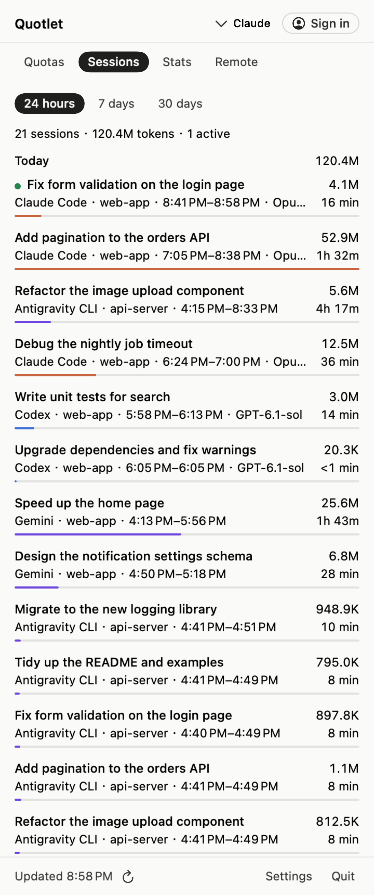
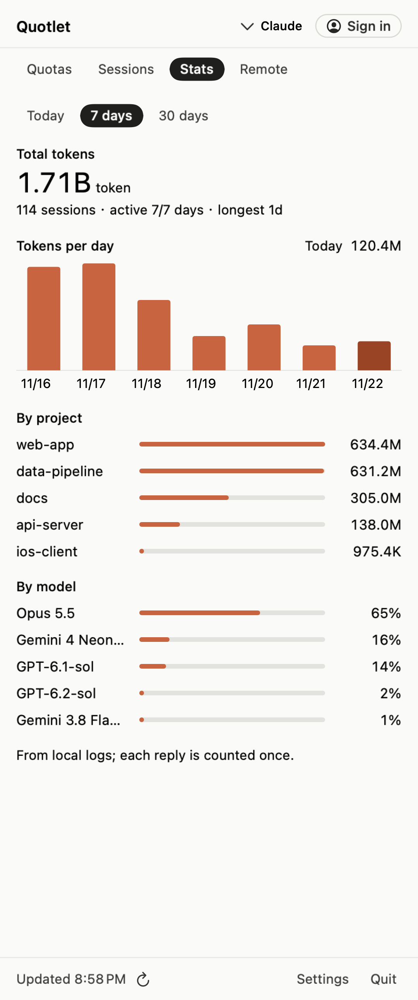

# Quotlet

**Your Claude plan limits in the macOS menu bar.**

English | [简体中文](README.zh-CN.md) | [日本語](README.ja.md) | [한국어](README.ko.md)

> **Quotlet was called Quotabar up to version 0.4.1.** Those releases are still named `Quotabar.app` / `Quotabar-<version>.dmg`. The GitHub repo moved from `tluo-github/quotabar` to `tluo-github/quotlet`; old links redirect.

Quotlet shows the same numbers as `/usage` in Claude Code: how much of your 5-hour session and weekly limits you've used, and when each one resets. Click it for details, your recent Claude Code sessions and token stats.

<a href="docs/demo-en.mp4"></a>

<sub>Click the animation for the MP4 video.</sub>

<p>
  
  
  
  
</p>

> Quotlet is an independent open-source project. It is not made by, affiliated with, or endorsed by Anthropic. "Claude" is a trademark of Anthropic.

## Features

- **Menu bar at a glance**: `5h 41% Wk 62%` (or just `41% 62%`), the share of your 5-hour and weekly limits used.
- **Usage**: every limit on your plan (5-hour session, weekly, per-model weekly such as Fable) with reset time, countdown and a tick showing how much of the window has passed. Green when healthy, amber and red as you near a limit, with a status badge next to your plan name.
- **Notifications**: when a limit is nearly used up (80%, 90% or 95%, your choice), when it's used up, and when it's available again after a reset.
- **Sessions**: Claude Code sessions from the last 24 hours, 7 or 30 days, with a bar showing which ones used the most tokens. Right-click to copy a `claude --resume` command.
- **Stats**: total tokens, tokens per day and tokens by project.
- **Four languages**: English, 简体中文, 日本語 and 한국어. Follows your system language or pick one in Settings. Light, dark or automatic appearance.
- Configurable refresh interval and an optional HTTP proxy, with a hint when Anthropic can't be reached.

## Requirements

- macOS 14 Sonoma or later, Apple silicon or Intel
- [Claude Code](https://docs.claude.com/en/docs/claude-code) installed and signed in with a Claude Pro or Max plan

## Install

### Download

Download **Quotlet-<version>.dmg** from [Releases](https://github.com/tluo-github/quotlet/releases/latest), open it and drag **Quotlet** into **Applications**. The app is signed and notarized by Apple, so it opens with a double-click.

### Homebrew

```bash
brew tap tluo-github/quotlet https://github.com/tluo-github/quotlet
brew trust tluo-github/quotlet
brew install --cask quotlet
```

Update with `brew upgrade --cask quotlet`, remove with `brew uninstall --cask quotlet`.

### After installing

- If the numbers don't show up in the menu bar, macOS may have tucked them into the hidden part of the menu bar. Hold **Command** and drag them where you want; macOS remembers the position.
- Settings (gear icon, bottom left): language, appearance, menu bar style, refresh interval, launch at login, proxy and notifications.

## How it works

| What | Source |
|---|---|
| Limits and reset times | `api.anthropic.com/api/oauth/usage`, the endpoint `/usage` uses |
| Sessions and tokens | Claude Code's local logs in `~/.claude/projects` |

- Quotlet reads the login Claude Code keeps in your Keychain (`Claude Code-credentials`) with the system `security` tool. It never refreshes or changes that login, and the only network request it makes is that one call to Anthropic.
- Claude Code logins expire every few hours and Claude Code renews them the next time you use it. If Quotlet says your login expired, send any message in Claude Code. Quotlet retries every minute and keeps showing the last data meanwhile.
- Token stats count each reply once. Claude Code writes the same usage on several log lines per reply; `/stats` appears to count every line, so its totals run about twice as high.
- Sessions and stats cover this Mac only. Usage on claude.ai, mobile or other computers counts toward your limits but doesn't appear in the session list.

> The usage endpoint isn't publicly documented. If Anthropic changes it, Quotlet may need an update.

## Refresh and proxy

- Limits refresh every 5 minutes by default (1 to 30 minutes in Settings). Anthropic doesn't publish a rate limit for this endpoint; very frequent refreshes can get rate limited (HTTP 429), and Quotlet then waits 5 minutes before trying again. Sessions and stats read local logs every minute.
- If Anthropic can't be reached, the Usage tab shows a hint with a button to the proxy settings. Turn on **Use HTTP proxy** and enter your proxy's host and port. The proxy is on by default (`127.0.0.1:7890`) when your system language is Chinese or your region is mainland China, Hong Kong or Macau.

## Build from source

Requires the Xcode Command Line Tools (`xcode-select --install`). No third-party dependencies.

```bash
git clone https://github.com/tluo-github/quotlet.git && cd quotlet
./build.sh            # build/Quotlet.app for this Mac
./build.sh install    # build, copy to /Applications and launch
./build.sh release    # universal build: dist/Quotlet-<version>.dmg and .zip
```

Development helpers:

```bash
# Render every tab (light and dark) to PNG without touching the menu bar
.build/release/Quotlet --snapshot /tmp/qb -AppleLanguages '(ja)' -stage YES -demo YES -scale 3
# Regenerate the README screenshots and demo videos for all four languages (needs ffmpeg)
scripts/make-demo.sh
# A window with the real panel on a clean background, for recording demos
.build/release/Quotlet --showcase -demo YES
# Redraw the app icon
swift scripts/make-icon.swift
```

`-demo YES` replaces session titles and project names with sample text so screenshots don't expose your own projects; `-offline YES` uses the cached usage instead of calling the API; `-scale 3` renders at 3× pixel density.

`./build.sh release` signs with your **Developer ID Application** certificate, notarizes and staples when that certificate is in your keychain (one-time setup: `xcrun notarytool store-credentials quotabar-notary --team-id <TEAM_ID>`); otherwise it builds an ad-hoc signed app.

| File | Purpose |
|---|---|
| `UsageAPI.swift` | Keychain login, usage request, proxy |
| `SessionScanner.swift` | Parses local Claude Code logs |
| `Store.swift` | Refresh schedule, settings, launch at login |
| `Views.swift` | Usage, Sessions, Stats and Settings |
| `Theme.swift` | Colors and type scale |
| `Format.swift` | Languages, dates, durations, token counts |
| `Notifier.swift` | Limit notifications |
| `Snapshot.swift`, `Showcase.swift`, `Demo.swift` | Screenshot, demo-window and sample-data helpers |
| `Casks/quotlet.rb` | Homebrew cask |

## License

[MIT](LICENSE)
