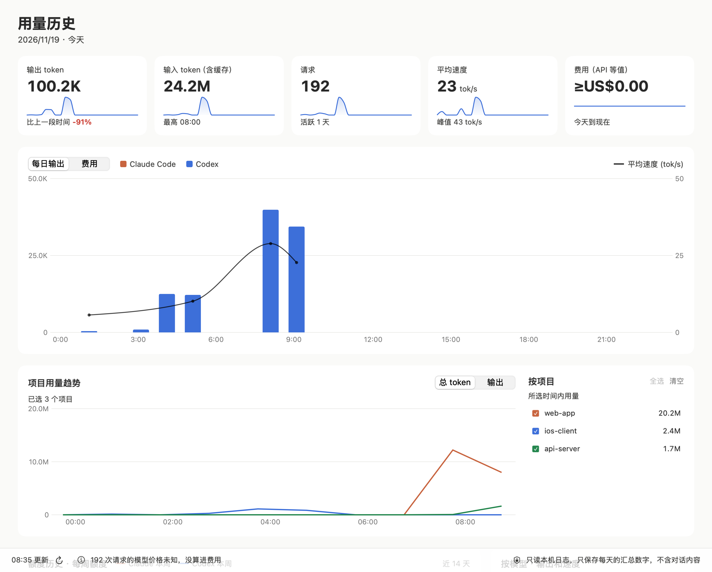

# Quotlet

**在 macOS 状态栏查看 Claude Code 和 Codex 用量。**

[English](README.md) | 简体中文 | [日本語](README.ja.md) | [한국어](README.ko.md)

> **Quotlet 在 0.4.1 及之前叫 Quotabar。** 那些版本的文件名还是 `Quotabar.app` / `Quotabar-<版本>.dmg`。GitHub 仓库从 `tluo-github/quotabar` 改名为 `tluo-github/quotlet`，旧链接会自动跳转。

Quotlet 默认从本机日志统计 Claude Code 和 Codex 的 token、会话、速度和 API 等值费用，不需要读取登录凭证。Codex 额度也来自本机日志；在设置中主动开启 Claude 额度接口后，才会查询和 `/usage` 一样的 5 小时、每周额度及重置时间。点「历史」可查看详细趋势。

<p>
  
  
</p>



> Quotlet 是独立的开源项目，不是 Anthropic 官方产品，与 Anthropic 没有关联。"Claude" 是 Anthropic 的商标。

## 功能

菜单栏面板顶部可直接切换「用量」「会话」「统计」，快速查看最近会话和 7 / 30 天用量，不用打开独立的「用量历史」窗口。

- **状态栏一眼看到**：Claude 本地模式显示今日 token；Codex 或已开启接口的 Claude 显示 `5h 41% 周 62%`（也可以只显示 `41% 62%`）。
- **可选的额度查询**：Claude 接口开启后，显示 5 小时、每周和按模型的额度；Codex 额度直接读取本机日志。一条一行，带重置时间和倒计时。
- **Claude 实时估算**：同一窗口内至少两次有效接口读数可校准本机 token 与额度变化的比例。查询间隔内随日志新增用量显示 `≈` 估算百分比，下一次接口读数到达后校正。模型、缓存和其他设备的使用会影响估算精度。校准数据保存在本次运行内，窗口重置或套餐变化后重新校准。估算值也参与额度通知，云端额度历史使用接口确认值。
- **切换推荐**：一家达到提醒阈值、另一家额度充裕时，用量页推荐先用另一家。
- **今天**：今天 Claude Code 和 Codex 的输出、输入 token、请求数、平均和峰值速度（tok/s），以及 API 等值费用。
- **用量历史窗口**：按来源和时间段（今天、昨天、7/30/90 天、今年、全部）筛选。项目趋势默认全选，可勾选项目对比折线，悬停查看各项目数值，并切换总 token 或输出 token。仍可查看每日输出、费用和速度、每周额度、模型分布和会话，也可以导出 CSV。每日汇总保存在本机，Claude Code 清理旧日志也不影响历史。
- **额度通知**：默认开启，达到 90%（可选 80% 或 95%）、用完 100%、重置恢复时提醒。Claude 和 Codex 的 5 小时、周额度均适用，Claude 的本机估算也会触发提醒并注明估算，每个窗口的每类提醒只发一次。首次启动时允许 macOS 通知。
- **可选的 Quotlet Cloud**：用 GitHub 登录后，在 [app.quotlet.com](https://app.quotlet.com) 的网页和手机上看额度和会话。不登录就不开启。
- **四种语言**：简体中文、English、日本語、한국어，默认跟随系统，也可以在设置里切换。外观支持浅色、深色和自动。
- 刷新频率可调，支持 HTTP 代理；连不上 Anthropic 时会提示去设置代理。

## 系统要求

- macOS 14 Sonoma 或更新，Apple 芯片和 Intel 都支持
- 本机有 Claude Code 或 Codex 会话日志；查询 Claude 订阅额度时，还需 Claude Code 已用 Pro 或 Max 套餐登录

## 安装

### 下载

从 [Releases](https://github.com/tluo-github/quotlet/releases/latest) 下载 **Quotlet-<版本>.dmg**，打开后把 **Quotlet** 拖进"应用程序"。app 已经过苹果签名和公证，双击就能打开。

### Homebrew

```bash
brew tap tluo-github/quotlet https://github.com/tluo-github/quotlet
brew trust tluo-github/quotlet
brew install --cask quotlet
```

升级用 `brew upgrade --cask quotlet`，卸载用 `brew uninstall --cask quotlet`。

### 装好以后

- 默认从本机 Claude Code 和 Codex 日志统计 token。需要 Claude 额度时，在设置 → 额度接口开启「查询 Claude 额度」。如果系统需要授权，点同一组里的「允许钥匙串访问」。通知默认开启，需允许 macOS 通知权限。已有的明确设置会保留。
- 状态栏上看不到数字的话，可能被系统收进了折叠区。按住 **Command** 把它拖到想要的位置，系统会记住。
- 设置（面板右下角）里有语言、外观、状态栏样式、刷新频率、开机启动、网络代理和通知。

## 原理

| 内容 | 来源 |
|---|---|
| 额度、重置时间 | `api.anthropic.com/api/oauth/usage`，也就是 `/usage` 用的接口 |
| 会话、token | 本机 `~/.claude/projects` 下的 Claude Code 日志 |
| Codex 的额度、会话、token | 本机 `~/.codex/sessions` 下的 Codex 日志（Codex 从 Claude Code 导入的会话会跳过） |

- 开启 Claude 额度接口后，Quotlet 通过系统钥匙串读取 Claude Code 的登录信息（`Claude Code-credentials`，兼容本机凭证文件），并向 Anthropic 查询额度。只有点「允许钥匙串访问」才可能弹出读取 Claude 凭证的系统授权框。Quotlet Cloud 是独立的可选登录功能，可将额度、token 数量和会话状态（不含提示词和代码）同步到 app.quotlet.com。启动时恢复云登录采用无交互方式。
- Claude Code 的登录每隔几个小时会过期，下次使用 Claude Code 时会自动续上。Quotlet 提示登录过期时，在 Claude Code 里随便发一句话就行。Quotlet 每分钟重试一次，期间继续显示上一次的数据。
- token 统计里同一条回复只算一次。Claude Code 会把同一条回复的用量写成好几行日志，`/stats` 看起来每一行都算了，所以数字大约多一倍。
- 速度 = 输出 token ÷ 这次回复花的时间（从发出请求到回复结束）。费用按各模型官方 API 价格估算，意思是「如果按 API 付费大约要花多少」；包月套餐实际不按这个收费，价格未知的模型（比如 Codex 的模型）不算进去。
- 会话和统计只包括这台电脑。claude.ai 网页版、手机和其他电脑上的用量会计入额度，但不会出现在会话列表里。

> 用量接口没有公开文档。如果 Anthropic 改了接口，Quotlet 可能需要更新。

## 刷新和代理

- Claude 额度接口默认关闭，开启后默认每 10 分钟刷新一次，设置里可以改成 1 到 30 分钟。Anthropic 没有公开这个接口的调用频率限制，刷新太频繁可能被限流（HTTP 429），这时 Quotlet 会暂停 5 分钟再试。会话和统计监听本机日志变化，合并短时间内的写入后更新，并每分钟兜底扫描一次。token 数字随客户端写入用量记录后更新。Claude 凭证授权方式由系统和条目的保护设置决定，可能需要登录钥匙串密码。
- 连不上 Anthropic 时，面板会显示提示和"去设置代理"按钮。开启 **使用 HTTP 代理** 并填写代理地址和端口即可。系统语言是中文、或地区设在中国大陆 / 香港 / 澳门时，代理默认开启（`127.0.0.1:7890`）。

## 从源码编译

需要 Xcode Command Line Tools（`xcode-select --install`），没有第三方依赖。

```bash
git clone https://github.com/tluo-github/quotlet.git && cd quotlet
./build.sh            # 编译出 build/Quotlet.app（本机架构）
./build.sh install    # 编译、复制到"应用程序"并启动
./build.sh release    # 通用架构编译，生成 dist/Quotlet-<版本>.dmg 和 .zip
```

开发辅助命令、代码结构见 [English README](README.md#build-from-source)。

## 许可证

[MIT](LICENSE)
