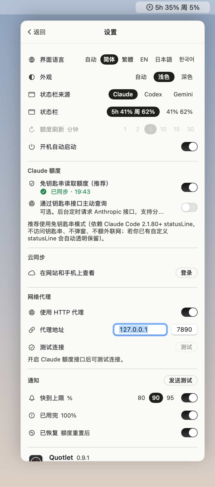

# Quotlet

**在 macOS 状态栏查看 Claude Code、Codex 和 Gemini 额度与实时速度（tok/s）。**

[English](README.md) | 简体中文 | [日本語](README.ja.md) | [한국어](README.ko.md)

> **Quotlet 在 0.4.1 及之前叫 Quotabar。** 那些版本的文件名还是 `Quotabar.app` / `Quotabar-<版本>.dmg`。GitHub 仓库从 `tluo-github/quotabar` 改名为 `tluo-github/quotlet`，旧链接会自动跳转。

Quotlet 默认从本机日志与本地服务统计 **Claude Code**、**Codex** 和 **Antigravity（Gemini）** 的 token、会话、实时输出吞吐（tok/s）和 API 等值费用，不需要读取登录凭证。Codex 额度来自本机日志，Gemini 额度来自本机 `127.0.0.1` 的 Antigravity 本地服务并支持离线缓存；在设置中主动开启 Claude 额度接口后，才会查询和 `/usage` 一样的 5 小时、每周额度及重置时间。点「历史」可查看详细趋势。

<p>
  
  
</p>


> Quotlet 是独立的开源项目，与 Anthropic、OpenAI 和 Google 均无关联。Claude、Codex 和 Gemini 分别为各自所有者的商标。

## 功能

菜单栏面板顶部实时展示本机全部 AI 输出吞吐（tok/s），下方可直接切换「额度」「会话」「统计」，快速查看三家额度、最近会话和 7 / 30 天用量，不用打开独立的「用量历史」窗口。

- **状态栏一眼看到**：面板顶部与设置页均可随时切换状态栏来源（Claude / Codex / Gemini），支持 `5h 41% 周 62%` 或简洁 `41% 62%`（Claude 本地模式显示今日 token）。
- **本机全部 AI 实时吞吐**：顶部实时速度仪表与 1 / 2 / 5 分钟输出曲线汇总 Claude、Codex 和 Gemini 并发输出（tok/s），分来源展示实时读数与峰值速度。
- **三家额度同屏对比**：Claude（可选接口）、Codex（本机日志）和 Gemini（本机 Antigravity 服务 + 离线缓存）的 5 小时、每周及细分模型额度一屏展示，均带重置时间与倒计时。
- **Claude 实时估算**：同一窗口内至少两次有效接口读数可校准本机 token 与额度变化的比例。查询间隔内随日志新增用量显示 `≈` 估算百分比，下一次接口读数到达后校正。模型、缓存和其他设备的使用会影响估算精度。校准数据保存在本次运行内，窗口重置或套餐变化后重新校准。估算值也参与额度通知，云端额度历史使用接口确认值。
- **跨工具切换推荐**：某一家达到提醒阈值而其他来源仍有充裕余量时，额度页顶部自动推荐先用更宽裕的一家。
- **今天**：今天 Claude Code、Codex 和 Gemini 的输出、输入 token、请求数、平均和峰值速度（tok/s），以及 API 等值费用。
- **用量历史窗口**：按来源（全部 / Claude Code / Codex / Gemini）和时间段（今天、昨天、7/30/90 天、今年、全部）筛选。支持三家堆叠柱状图叠加速度曲线、项目趋势折线（默认全选，可勾选对比总 token 或输出 token）、每周额度、模型分布和会话表，并可导出 CSV。每日汇总保存在本机，旧日志清理后也不影响历史。
- **额度通知**：默认开启，达到 90%（可选 80% 或 95%）、用完 100%、重置恢复时提醒。Claude、Codex 和 Gemini 的各窗口均适用，Claude 本机估算也会触发提醒并注明估算，每个窗口的每类提醒只发一次。首次启动时允许 macOS 通知。
- **可选的 Quotlet Cloud**：用 GitHub 登录后，在 [app.quotlet.com](https://app.quotlet.com) 的网页和手机上统一查看 Claude、Codex 和 Gemini 的额度、会话、用量分析与网页内告警。不登录就不开启。
- **四种语言**：简体中文、English、日本語、한국어，默认跟随系统，也可以在设置里切换。外观支持浅色、深色和自动。
- 刷新频率可调，支持 HTTP 代理；连不上 Anthropic 时会提示去设置代理。

## 系统要求

- macOS 13 Ventura 或更新，Apple 芯片和 Intel 都支持
- 本机有 Claude Code、Codex 或 Antigravity（Gemini）日志；查询 Claude 订阅额度时，还需 Claude Code 已用 Pro 或 Max 套餐登录

## 安装

### 让 AI 帮你安装

把下面这段话发给能在 Mac 上执行命令的 AI 助手。

> 请帮我在这台 Mac 上安装 Quotlet。按官网 https://quotlet.com 的说明操作，官方安装包在 https://github.com/tluo-github/quotlet。先确认 macOS 为 13 或更新版本，再使用 Homebrew 或已签名公证的正式安装包安装，完成后启动 Quotlet。

### 下载

从 [Releases](https://github.com/tluo-github/quotlet/releases/latest) 按芯片下载 **Quotlet-<版本>-arm64.dmg**（Apple 芯片）或 **Quotlet-<版本>-x86_64.dmg**（Intel 芯片），打开后把 **Quotlet** 拖进"应用程序"。app 已经过苹果签名和公证，双击就能打开。

### Homebrew

```bash
brew tap tluo-github/quotlet https://github.com/tluo-github/quotlet
brew trust tluo-github/quotlet
brew install --cask quotlet
```

升级用 `brew upgrade --cask quotlet`，卸载用 `brew uninstall --cask quotlet`。

### 装好以后

- 默认从本机 Claude Code、Codex 和 Antigravity（Gemini）日志统计 token 与实时速度，并通过本机 `127.0.0.1` 的 Antigravity 服务读取 Gemini 额度。需要 Claude 额度时，在设置 → 额度接口开启「查询 Claude 额度」。如果系统需要授权，点同一组里的「允许钥匙串访问」。通知默认开启，需允许 macOS 通知权限。已有的明确设置会保留。
- 状态栏上看不到数字的话，可能被系统收进了折叠区。按住 **Command** 把它拖到想要的位置，系统会记住。
- 设置（面板右下角）里有语言、外观、状态栏来源与样式、刷新频率、开机启动、网络代理和通知。

## 原理

| 内容 | 来源 |
|---|---|
| Claude 额度、重置时间 | `api.anthropic.com/api/oauth/usage`（可选，默认关闭） |
| Claude 会话、token | 本机 `~/.claude/projects` 下的 Claude Code 日志 |
| Codex 的额度、会话、token | 本机 `~/.codex/sessions` 下的 Codex 日志（Codex 从 Claude Code 导入的会话会跳过） |
| Gemini 的额度、会话、token | 本机 `127.0.0.1` 的 Antigravity 本地服务（`~/.gemini/antigravity/daemon/hub_*.json`，支持离线缓存）与 `~/.gemini/antigravity/brain` 只读日志 |

- 开启 Claude 额度接口后，Quotlet 通过系统钥匙串读取 Claude Code 的登录信息（`Claude Code-credentials`，兼容本机凭证文件），并向 Anthropic 查询额度。只有点「允许钥匙串访问」才可能弹出读取 Claude 凭证的系统授权框。Quotlet Cloud 是独立的可选登录功能，可将额度、token 数量和会话状态（不含提示词和代码）同步到 app.quotlet.com。启动时恢复云登录采用无交互方式。
- Claude Code 的登录每隔几个小时会过期，下次使用 Claude Code 时会自动续上。Quotlet 提示登录过期时，在 Claude Code 里随便发一句话就行。Quotlet 每分钟重试一次，期间继续显示上一次的数据。
- token 统计里同一条回复只算一次。Claude Code 会把同一条回复的用量写成好几行日志，`/stats` 看起来每一行都算了，所以数字大约多一倍。
- 速度 = 输出 token ÷ 这次回复花的时间（从发出请求到回复结束）。费用按各模型官方 API 价格估算，意思是「如果按 API 付费大约要花多少」；包月套餐实际不按这个收费，价格未知的模型（比如 Codex 的模型）不算进去。
- 会话和统计只包括这台电脑。claude.ai 网页版、手机和其他电脑上的用量会计入额度，但不会出现在会话列表里。

> 用量接口没有公开文档。如果 Anthropic 改了接口，Quotlet 可能需要更新。

## 刷新和代理

- Claude 额度接口默认关闭，开启后默认每 10 分钟刷新一次，设置里可以改成 1 到 30 分钟。Anthropic 没有公开这个接口的调用频率限制，刷新太频繁可能被限流（HTTP 429），这时 Quotlet 会暂停 5 分钟再试。会话和统计监听本机日志变化，合并短时间内的写入后更新，并每分钟兜底扫描一次。token 数字随客户端写入用量记录后更新。Claude 凭证授权方式由系统和条目的保护设置决定，可能需要登录钥匙串密码。
- 连不上 Anthropic 时，面板会显示提示和"去设置代理"按钮。开启 **使用 HTTP 代理** 并填写代理地址和端口即可。系统语言是中文、或地区设在中国大陆 / 香港 / 澳门时，代理默认开启（`127.0.0.1:7890`）。

## 从源码编译

需要 Xcode Command Line Tools（`xcode-select --install`），没有第三方依赖。

```bash
git clone https://github.com/tluo-github/quotlet.git && cd quotlet
./build.sh            # 编译出 build/Quotlet.app（本机架构）
./build.sh install    # 编译、复制到"应用程序"并启动
./build.sh release    # 分别编译 Apple 芯片与 Intel 芯片安装包：dist/Quotlet-<版本>-{arm64,x86_64}.{dmg,zip}
```

开发辅助命令、代码结构见 [English README](README.md#build-from-source)。

## 许可证

[MIT](LICENSE)
