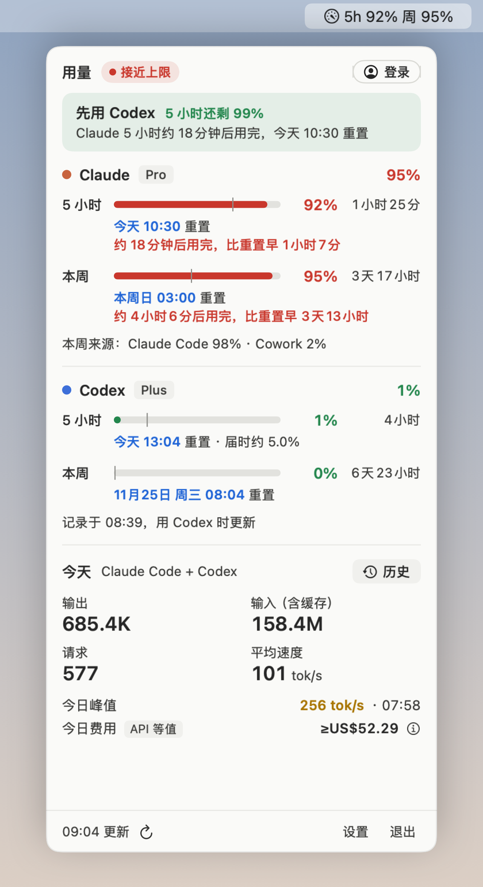
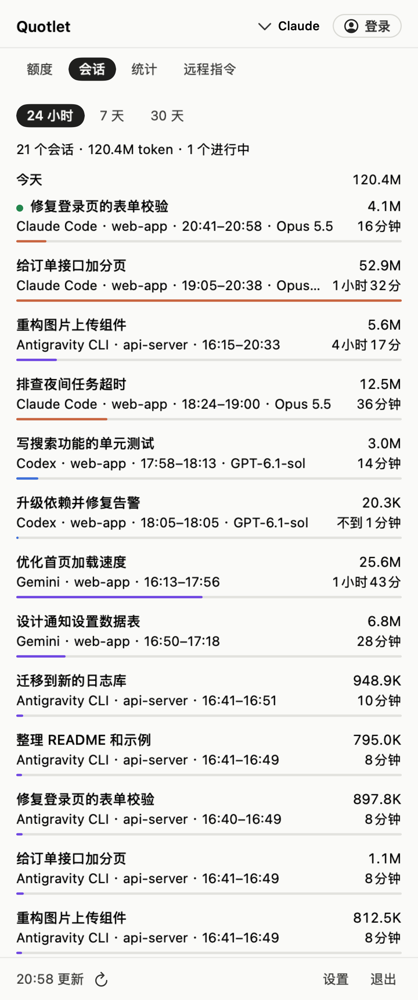
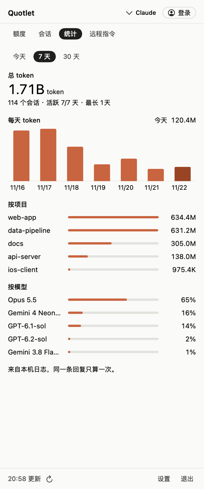

# Quotlet

**在 macOS 状态栏查看 Claude 套餐用量。**

[English](README.md) | 简体中文 | [日本語](README.ja.md) | [한국어](README.ko.md)

> **Quotlet 在 0.4.1 及之前叫 Quotabar。** 那些版本的文件名还是 `Quotabar.app` / `Quotabar-<版本>.dmg`。GitHub 仓库从 `tluo-github/quotabar` 改名为 `tluo-github/quotlet`，旧链接会自动跳转。

Quotlet 显示的数字和 Claude Code 里的 `/usage` 一样：5 小时窗口和每周额度各用了多少、什么时候重置。点开还能看最近的 Claude Code 会话和 token 统计。

<a href="docs/demo-zh.mp4"></a>

<sub>点击动图可以看 MP4 视频。</sub>

<p>
  
  
  
  
</p>

> Quotlet 是独立的开源项目，不是 Anthropic 官方产品，与 Anthropic 没有关联。"Claude" 是 Anthropic 的商标。

## 功能

- **状态栏一眼看到**：`5h 41% 周 62%`（也可以只显示 `41% 62%`），即 5 小时窗口和本周额度的已用比例。
- **用量**：套餐里的每一条额度（5 小时、每周、按模型的每周额度如 Fable），带重置时间、倒计时和时间进度刻度。正常时是绿色，快用完时变成琥珀色、红色，标题旁有健康状态标签。
- **通知**：额度快到上限（80%、90% 或 95%，可选）、已用完、重置后恢复时提醒你。
- **会话**：近 24 小时 / 7 天 / 30 天的 Claude Code 会话，每行有一条比例条，看出哪个会话用得多。右键可以复制 `claude --resume` 恢复命令。
- **统计**：总 token、每天 token、按项目统计。
- **四种语言**：简体中文、English、日本語、한국어，默认跟随系统，也可以在设置里切换。外观支持浅色、深色和自动。
- 刷新频率可调，支持 HTTP 代理；连不上 Anthropic 时会提示去设置代理。

## 系统要求

- macOS 14 Sonoma 或更新，Apple 芯片和 Intel 都支持
- 已安装 [Claude Code](https://docs.claude.com/en/docs/claude-code)，并用 Claude Pro 或 Max 套餐登录

## 安装

### 下载

从 [Releases](https://github.com/tluo-github/quotlet/releases/latest) 下载 **Quotlet-<版本>.dmg**，打开后把 **Quotlet** 拖进"应用程序"。app 已经过苹果签名和公证，双击就能打开。

### Homebrew

```bash
brew tap tluo-github/quotlet https://github.com/tluo-github/quotlet
brew install --cask quotlet
```

升级用 `brew upgrade --cask quotlet`，卸载用 `brew uninstall --cask quotlet`。

### 装好以后

- 状态栏上看不到数字的话，可能被系统收进了折叠区。按住 **Command** 把它拖到想要的位置，系统会记住。
- 设置（左下角齿轮）里有语言、外观、状态栏样式、刷新频率、开机启动、网络代理和通知。

## 原理

| 内容 | 来源 |
|---|---|
| 额度、重置时间 | `api.anthropic.com/api/oauth/usage`，也就是 `/usage` 用的接口 |
| 会话、token | 本机 `~/.claude/projects` 下的 Claude Code 日志 |

- Quotlet 用系统自带的 `security` 命令读取 Claude Code 存在钥匙串里的登录信息（`Claude Code-credentials`）。它不会刷新或改动这个登录，唯一的网络请求就是向 Anthropic 查询用量。
- Claude Code 的登录每隔几个小时会过期，下次使用 Claude Code 时会自动续上。Quotlet 提示登录过期时，在 Claude Code 里随便发一句话就行。Quotlet 每分钟重试一次，期间继续显示上一次的数据。
- token 统计里同一条回复只算一次。Claude Code 会把同一条回复的用量写成好几行日志，`/stats` 看起来每一行都算了，所以数字大约多一倍。
- 会话和统计只包括这台电脑。claude.ai 网页版、手机和其他电脑上的用量会计入额度，但不会出现在会话列表里。

> 用量接口没有公开文档。如果 Anthropic 改了接口，Quotlet 可能需要更新。

## 刷新和代理

- 额度默认每 5 分钟刷新一次，设置里可以改成 1 到 30 分钟。Anthropic 没有公开这个接口的调用频率限制，刷新太频繁可能被限流（HTTP 429），这时 Quotlet 会暂停 5 分钟再试。会话和统计读本机日志，每分钟更新。
- 连不上 Anthropic 时，用量页会显示提示和"去设置代理"按钮。开启 **使用 HTTP 代理** 并填写代理地址和端口即可。系统语言是中文、或地区设在中国大陆 / 香港 / 澳门时，代理默认开启（`127.0.0.1:7890`）。

## 从源码编译

需要 Xcode Command Line Tools（`xcode-select --install`），没有第三方依赖。

```bash
git clone https://github.com/tluo-github/quotlet.git && cd quotlet
./build.sh            # 编译出 build/Quotlet.app（本机架构）
./build.sh install    # 编译、复制到"应用程序"并启动
./build.sh release    # 通用架构编译，生成 dist/Quotlet-<版本>.dmg 和 .zip
```

开发辅助命令、代码结构见 [English README](README.md#build-from-source)。

## 许可证

[MIT](LICENSE)
