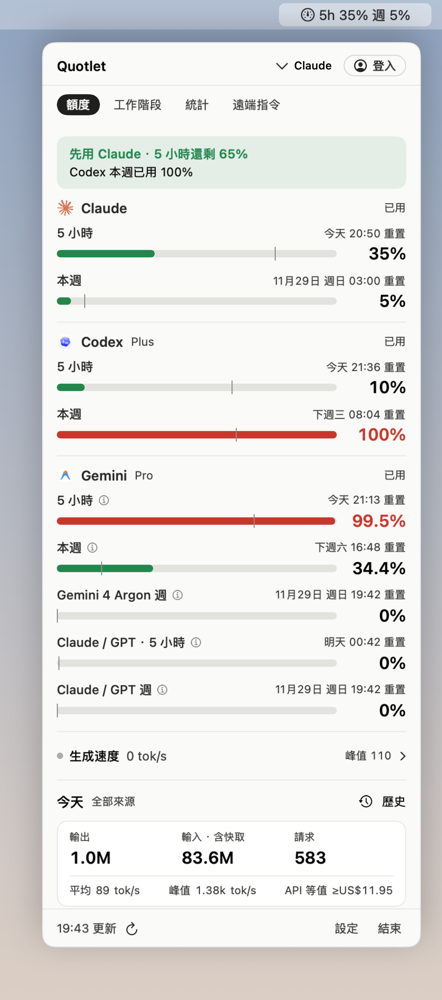
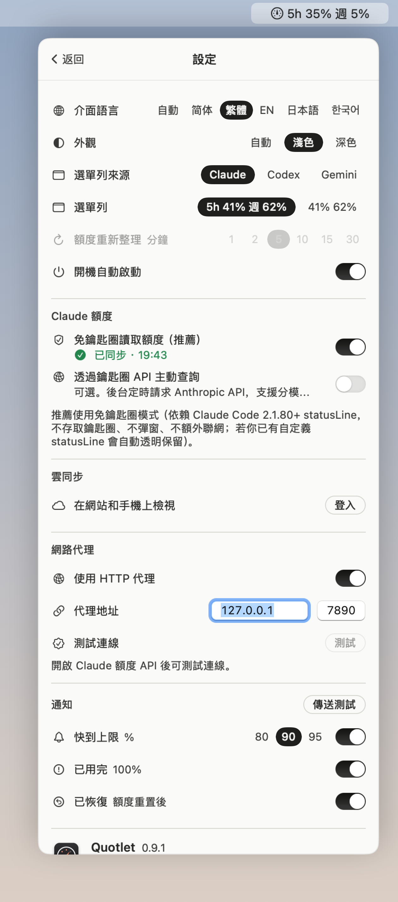
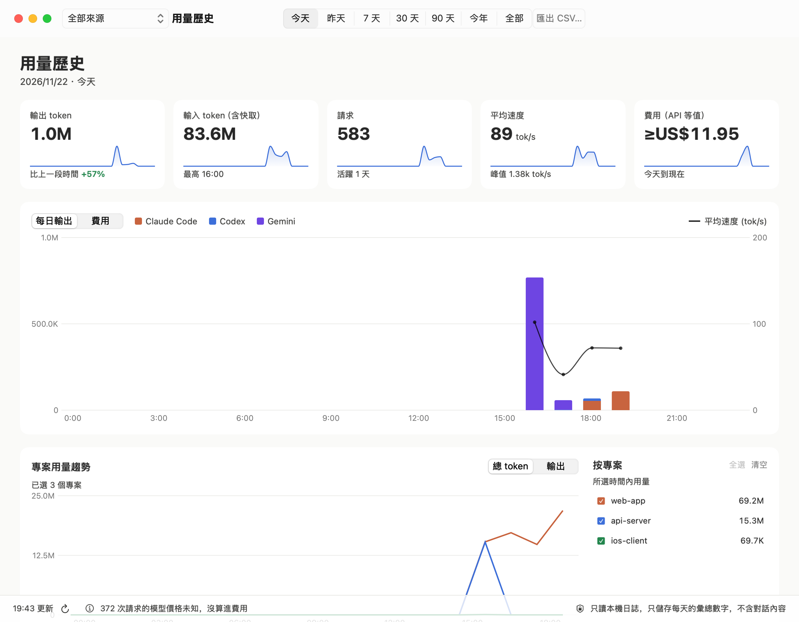

<!-- 自动生成，不要手改：改 README.zh-CN.md 后运行 uv run --with opencc python3 scripts/gen-zh-hant.py -->


# Quotlet

**在 macOS 選單列檢視 Claude Code、Codex 和 Gemini 額度與即時速度（tok/s）。**

[English](README.md) | [简体中文](README.zh-CN.md) | 繁體中文 | [日本語](README.ja.md) | [한국어](README.ko.md)

> **Quotlet 在 0.4.1 及之前叫 Quotabar。** 那些版本的檔名還是 `Quotabar.app` / `Quotabar-<版本>.dmg`。GitHub 儲存庫從 `tluo-github/quotabar` 改名為 `tluo-github/quotlet`，舊連結會自動跳轉。

Quotlet 預設從本機日誌與本地服務統計 **Claude Code**、**Codex** 和 **Antigravity（Gemini）** 的 token、工作階段、即時輸出吞吐（tok/s）和 API 等值費用，不需要讀取登入憑證。Codex 額度來自本機日誌，Gemini 額度來自本機 `127.0.0.1` 的 Antigravity 本地服務並支援離線快取；在設定中主動開啟 Claude 額度 API 後，才會查詢和 `/usage` 一樣的 5 小時、每週額度及重置時間。點「歷史」可檢視詳細趨勢。

<p>
  
  
</p>



> Quotlet 是獨立的開源專案，與 Anthropic、OpenAI 和 Google 均無關聯。Claude、Codex 和 Gemini 分別為各自所有者的商標。

## 功能

選單列面板頂部即時展示本機全部 AI 輸出吞吐（tok/s），下方可直接切換「額度」「工作階段」「統計」，快速檢視三家額度、最近工作階段和 7 / 30 天用量，不用開啟獨立的「用量歷史」視窗。

- **選單列一眼看到**：面板頂部與設定頁均可隨時切換選單列來源（Claude / Codex / Gemini），支援 `5h 41% 週 62%` 或簡潔 `41% 62%`（Claude 本地模式顯示今日 token）。
- **本機全部 AI 即時吞吐**：頂部即時速度儀表與 1 / 2 / 5 分鐘輸出曲線彙總 Claude、Codex 和 Gemini 並行輸出（tok/s），分來源展示即時讀數與峰值速度。
- **三家額度同屏對比**：Claude（可選 API）、Codex（本機日誌）和 Gemini（本機 Antigravity 服務 + 離線快取）的 5 小時、每週及細分模型額度一屏展示，均帶重置時間與倒數計時。
- **Claude 即時估算**：同一時段內至少兩次有效 API 讀數可校準本機 token 與額度變化的比例。查詢間隔內隨日誌新增用量顯示 `≈` 估算百分比，下一次 API 讀數到達後校正。模型、快取和其他裝置的使用會影響估算精度。校準資料儲存在本次執行內，視窗重置或方案變化後重新校準。估算值也參與額度通知，雲端額度歷史使用 API 確認值。
- **跨工具切換推薦**：某一家達到提醒閾值而其他來源仍有充裕餘量時，額度頁頂部自動推薦先用更寬裕的一家。
- **今天**：今天 Claude Code、Codex 和 Gemini 的輸出、輸入 token、請求數、平均和峰值速度（tok/s），以及 API 等值費用。
- **用量歷史視窗**：按來源（全部 / Claude Code / Codex / Gemini）和時間段（今天、昨天、7/30/90 天、今年、全部）篩選。支援三家堆疊長條圖疊加速度曲線、專案趨勢折線（預設全選，可勾選對比總 token 或輸出 token）、每週額度、模型分佈和工作階段表，並可匯出 CSV。每日彙總儲存在本機，舊日誌清理後也不影響歷史。
- **額度通知**：預設開啟，達到 90%（可選 80% 或 95%）、用完 100%、重置恢復時提醒。Claude、Codex 和 Gemini 的各視窗均適用，Claude 本機估算也會觸發提醒並註明估算，每個視窗的每類提醒只發一次。首次啟動時允許 macOS 通知。
- **可選的 Quotlet Cloud**：用 GitHub 登入後，在 [app.quotlet.com](https://app.quotlet.com) 的網頁和手機上統一檢視 Claude、Codex 和 Gemini 的額度、工作階段、用量分析與網頁內告警。不登入就不開啟。
- **五種語言**：簡體中文、繁體中文、English、日本語、한국어，預設跟隨系統，也可以在設定裡切換。外觀支援淺色、深色和自動。
- 重新整理頻率可調，支援 HTTP 代理；連不上 Anthropic 時會提示去設定代理。

## 系統要求

- macOS 13 Ventura 或更新，Apple 晶片和 Intel 都支援
- 本機有 Claude Code、Codex 或 Antigravity（Gemini）日誌；查詢 Claude 訂閱額度時，還需 Claude Code 已用 Pro 或 Max 方案登入

## 安裝

### 讓 AI 幫你安裝

把下面這段話發給能在 Mac 上執行命令的 AI 助手。

> 請幫我在這台 Mac 上安裝 Quotlet。按官網 https://quotlet.com 的說明操作，官方安裝檔在 https://github.com/tluo-github/quotlet。先確認 macOS 為 13 或更新版本，再使用 Homebrew 或已簽署公證的正式安裝檔安裝，完成後啟動 Quotlet。

### 下載

從 [Releases](https://github.com/tluo-github/quotlet/releases/latest) 按晶片下載 **Quotlet-<版本>-arm64.dmg**（Apple 晶片）或 **Quotlet-<版本>-x86_64.dmg**（Intel 晶片），開啟後把 **Quotlet** 拖進"應用程式"。app 已經過蘋果簽署和公證，雙擊就能開啟。

### Homebrew

```bash
brew tap tluo-github/quotlet https://github.com/tluo-github/quotlet
brew trust tluo-github/quotlet
brew install --cask quotlet
```

升級用 `brew upgrade --cask quotlet`，解除安裝用 `brew uninstall --cask quotlet`。

### 裝好以後

- 預設從本機 Claude Code、Codex 和 Antigravity（Gemini）日誌統計 token 與即時速度，並透過本機 `127.0.0.1` 的 Antigravity 服務讀取 Gemini 額度。需要 Claude 額度時，在設定 → 額度 API 開啟「查詢 Claude 額度」。如果系統需要授權，點同一組裡的「允許鑰匙圈存取」。通知預設開啟，需允許 macOS 通知權限。已有的明確設定會保留。
- 選單列上看不到數字的話，可能被系統收進了摺疊區。按住 **Command** 把它拖到想要的位置，系統會記住。
- 只安裝 Antigravity CLI（`agy`）也能使用：無需 Antigravity App，即可識別 CLI 安裝並獨立顯示工作階段、最近使用的模型和 token 用量。工作階段從 `~/.gemini/antigravity-cli/brain` 及其工作階段資料庫讀取；未取得到額度時顯示暫無額度，不影響本地統計。
- 多台 Mac 登入同一個 Quotlet Cloud 帳號時共享額度：某台 Mac 讀不到某個來源的額度（例如只裝了 `agy`），會顯示其他 Mac 回報的最新 5 小時和每週額度，並標出來自哪台 Mac；面板「今天」下方還會顯示全部 Mac 的今日合計，同一工作階段只算一次。
- 設定（面板右下角）裡有語言、外觀、選單列來源與樣式、重新整理頻率、開機啟動、網路代理和通知。

## 原理

| 內容 | 來源 |
|---|---|
| Claude 額度、重置時間 | `api.anthropic.com/api/oauth/usage`（可選，預設關閉） |
| Claude 工作階段、token | 本機 `~/.claude/projects` 下的 Claude Code 日誌 |
| Codex 的額度、工作階段、token | 本機 `~/.codex/sessions` 下的 Codex 日誌（Codex 從 Claude Code 匯入的工作階段會跳過） |
| Gemini 的額度、工作階段、token | 本機 `127.0.0.1` 的 Antigravity 本地服務（探測 IDE 與 CLI 各自的 `daemon/hub_*.json`，支援離線快取）；工作階段與 token 獨立讀取 `~/.gemini/antigravity/brain` 和 `~/.gemini/antigravity-cli/brain` 日誌 |

- 開啟 Claude 額度 API 後，Quotlet 透過系統鑰匙圈讀取 Claude Code 的登入資訊（`Claude Code-credentials`，相容本機憑證檔案），並向 Anthropic 查詢額度。只有點「允許鑰匙圈存取」才可能彈出讀取 Claude 憑證的系統授權框。Quotlet Cloud 是獨立的可選登入功能，可將額度、token 數量和工作階段狀態（不含提示詞和程式碼）同步到 app.quotlet.com。啟動時恢復雲登入採用無互動方式。
- Claude Code 的登入每隔幾個小時會過期，下次使用 Claude Code 時會自動續上。Quotlet 提示登入過期時，在 Claude Code 裡隨便發一句話就行。Quotlet 每分鐘重試一次，期間繼續顯示上一次的資料。
- token 統計裡同一條回覆只算一次。Claude Code 會把同一條回覆的用量寫成好幾行日誌，`/stats` 看起來每一行都算了，所以數字大約多一倍。
- 速度 = 輸出 token ÷ 這次回覆花的時間（從發出請求到回覆結束）。費用按各模型官方 API 價格估算，意思是「如果按 API 付費大約要花多少」；包月方案實際不按這個收費，價格未知的模型（比如 Codex 的模型）不算進去。
- 工作階段和統計只包括這台電腦。claude.ai 網頁版、手機和其他電腦上的用量會計入額度，但不會出現在工作階段列表裡。

> 用量 API 沒有公開文件。如果 Anthropic 改了 API，Quotlet 可能需要更新。

## 重新整理和代理

- Claude 額度 API 預設關閉，開啟後預設每 10 分鐘重新整理一次，設定裡可以改成 1 到 30 分鐘。Anthropic 沒有公開這個 API 的呼叫頻率限制，重新整理太頻繁可能被限流（HTTP 429），這時 Quotlet 會暫停 5 分鐘再試。工作階段和統計監聽本機日誌變化，合併短時間內的寫入後更新，並每分鐘兜底掃描一次。token 數字隨用戶端寫入用量記錄後更新。Claude 憑證授權方式由系統和條目的保護設定決定，可能需要登入鑰匙圈密碼。
- 連不上 Anthropic 時，面板會顯示提示和"去設定代理"按鈕。開啟 **使用 HTTP 代理** 並填寫代理地址和埠即可。系統語言是中文、或地區設在中國大陸 / 香港 / 澳門時，代理預設開啟（`127.0.0.1:7890`）。

## 從原始碼編譯

需要 Xcode Command Line Tools（`xcode-select --install`），沒有第三方依賴。

```bash
git clone https://github.com/tluo-github/quotlet.git && cd quotlet
./build.sh            # 編譯出 build/Quotlet.app（本機架構）
./build.sh install    # 編譯、複製到"應用程式"並啟動
./build.sh release    # 分別編譯 Apple 晶片與 Intel 晶片安裝檔：dist/Quotlet-<版本>-{arm64,x86_64}.{dmg,zip}
```

開發輔助命令、程式碼結構見 [English README](README.md#build-from-source)。

## 授權條款

[MIT](LICENSE)
