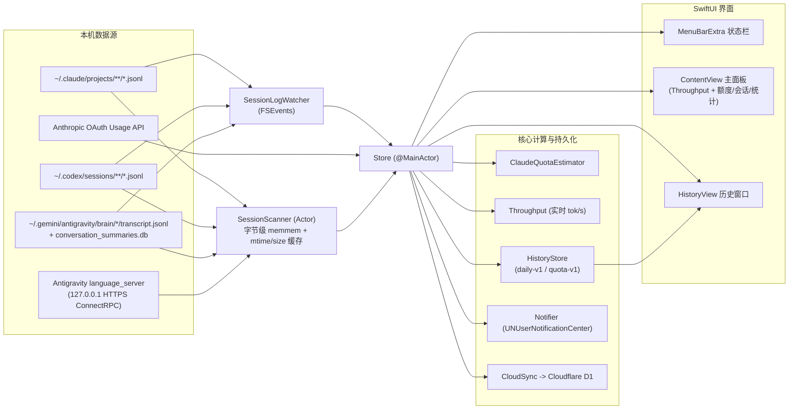

# Quotlet 系统架构文档

Quotlet 是一款 macOS 原生菜单栏应用（Swift / SwiftUI，macOS 14+），用于统一监控本机 **Claude Code**、**Codex** 和 **Antigravity（Gemini）** 的额度剩余、重置时间、实时吞吐速度（tok/s）、会话活动、历史趋势与 API 等值费用，并可选同步到 Quotlet Cloud 在网页与手机端查看。

---

## 1. 总体架构与目录结构

```text
quotlet/
├── Package.swift                 # SwiftPM 工程定义（macOS 14+，零第三方 Swift 依赖）
├── build.sh                      # 编译、打包 Quotlet.app、签名与发布脚本
├── Sources/Quotlet/              # macOS 菜单栏客户端源码
│   ├── App.swift                 # 应用入口（MenuBarExtra + URL 回调 AppDelegate）
│   ├── Store.swift               # @MainActor 全局状态中心（定时刷新、FSEvents 联动、状态栏文本）
│   ├── SessionScanner.swift      # Actor 并发扫描器 + Claude 日志解析 + LocalSnapshot 模型
│   ├── SessionLogWatcher.swift   # CoreServices FSEvents 目录监听器（防抖 0.5s）
│   ├── UsageAPI.swift            # Claude Code OAuth 额度接口、Keychain 读取、本地缓存与代理
│   ├── ClaudeQuotaEstimator.swift# 两次 Claude API 刷新间的本机 Token 增量估算校准器
│   ├── Codex.swift               # Codex 日志解析（token_count / rate_limits / LiveActivity）
│   ├── Gemini.swift              # Antigravity（Gemini）本地 ConnectRPC 配额查询 + 日志/SQLite 解析
│   ├── Throughput.swift          # 实时吞吐引擎（多来源并发区间叠加 + 生成中速度估算）
│   ├── ThroughputView.swift      # 面板顶部实时吞吐仪表盘、折线图与状态栏来源切换器
│   ├── Pricing.swift             # 官方 API 标价表、UsageStats 汇总模型与费用/速度格式化
│   ├── HistoryStore.swift        # 本地持久化归档（daily-v1.json 每日汇总 + quota-v1.json 120天曲线）
│   ├── History.swift             # 独立用量历史窗口（多维筛选、堆叠柱图、模型/项目分布、CSV 导出）
│   ├── Views.swift               # 主面板 ContentView、额度卡片 UsageTab、今日汇总 TodayBlock、设置页
│   ├── QuickUsage.swift          # 主面板「会话」页 SessionsTab 与「统计」页 StatsTab
│   ├── Advice.swift              # 跨工具额度切换建议卡片（Claude / Codex / Gemini）
│   ├── Notifier.swift            # macOS 系统通知（快到上限 / 已用完 / 重置已恢复，去重防抖）
│   ├── Cloud.swift / CloudSync.swift # GitHub OAuth 登录、增量云端上报与 Hook 状态合并
│   ├── CLICapabilities.swift     # 本机 Claude / Codex / Antigravity CLI 能力探测与上报
│   ├── HookEvents.swift / HookInstaller.swift # --hook 极速命令行分支、events.jsonl 监听与 hooks 安全装卸
│   ├── CommandSecurity.swift / ProviderRunner.swift # 30 天目录白名单、终端冲突保护、统一三来源执行器与指令审计
│   ├── CloudRealtime.swift       # /api/ws WebSocket 长连接、离线指令对账与远程指令调度器
│   ├── Format.swift / Theme.swift# 多语言（zh/zh-Hant/en/ja/ko，繁体由 ZhHant 对照表自动转换，表用 scripts/gen-zh-hant.py 生成）、时区/日期/模型名格式化与动态浅深色主题
│   ├── KeychainAccess.swift      # 钥匙串静默读取保护（禁止后台意外弹窗）
│   ├── Demo.swift / Snapshot.swift / Showcase.swift # 演示脱敏模式与自动截图工具
│   └── ProviderAssets/           # 品牌图标（claude.png / codex.png / gemini.png）
├── Tests/QuotletTests/           # 单元测试（估算器、通知去重、吞吐计算、FSEvents、Gemini、Hooks、远程指令安全与执行器）
└── site/                         # 官方门户静态站点（Cloud / iOS / Android 位于独立私有仓库 quotlet-cloud）
```

### 数据流全景



---

## 2. 三大 AI 提供商的接入架构

Quotlet 采用统一抽象：**本地会话/Token/速度**汇聚到 `LocalSnapshot`（区分 `Source`: `.claude` / `.codex` / `.gemini`），**配额窗口**统一映射为 `[LimitItem]`（全部归一化为 **已用百分比 0%~100%** + 重置时刻 `resetsAt`）。

| 维度 | Claude Code (`UsageAPI.swift`) | Codex (`Codex.swift`) | Antigravity / Gemini (`Gemini.swift`) |
| :--- | :--- | :--- | :--- |
| **额度来源** | 远端 HTTPS API：`https://api.anthropic.com/api/oauth/usage`（默认关闭，用户开启后生效） | 本机日志 `event_msg / token_count` 中的 `rate_limits` 字段（零网络请求） | 本地后台 `language_server` 的 ConnectRPC 接口（`RetrieveUserQuotaSummary` + `GetLoadCodeAssist`） |
| **认证与发现** | Keychain（`Claude Code-credentials`，支持静默读取避免弹窗）或 `~/.claude/.credentials.json` | 无需认证，直接只读日志 | 扫描 `~/.gemini/antigravity/daemon/hub_*.json` 获取 `httpsPort`、`csrfToken` 并校验 `pid` 存活 |
| **配额窗口** | `session`（5h）、`weekly_all`、`weekly_scoped`（Opus/Sonnet） | `primary`（5h，`session`）、`secondary`（周，`weekly_all`） | Pro：`gemini-5h`（`session`）、`gemini-weekly`（`weekly_all`）、`gemini-argon-wtu-weekly`（`weekly_scoped`）、`3p-5h`（`session_scoped`）、`3p-weekly`（`weekly_scoped`）；Free：周额度 |
| **百分比语义** | 接口直接返回已用百分比 | 日志直接记录 `used_percent` | 接口返回 `remainingFraction`（剩余 0~1），转换为 `used = (1 - remainingFraction) * 100` |
| **离线/缓存策略** | `~/Library/Caches/<bundle>/usage.json` | 保留日志最近一条记录，过期自动归零 | `~/Library/Caches/<bundle>/gemini-usage.json`，Antigravity 关闭后仍保持读数与倒计时，已过重置时间自动归零 |
| **本地会话日志** | `~/.claude/projects/<proj>/*.jsonl` 及 `subagents/*.jsonl` | `~/.codex/sessions/**/*.jsonl` + `archived_sessions`（排除导入的外部会话） | `~/.gemini/antigravity/brain/<id>/.system_generated/logs/transcript.jsonl` + `conversation_summaries.db`（只读 `immutable=1`） |
| **实时状态** | 支持 `LiveActivity`（`.generating` / `.tools` / `.idle`） | 支持 `LiveActivity`（`.generating` / `.tools` / `.idle`） | 完成后写入 `transcript.jsonl`，完成后计入吞吐曲线 |

### 2.1 高性能日志扫描机制 (`SessionScanner`)
- **增量文件缓存**：以 `文件路径 -> (mtime, size, 解析结果)` 缓存，未变化的文件零 IO 开销。
- **字节级预过滤**：使用 C 函数 `memmem` 扫描内存映射文件（`Data(contentsOf:options:.mappedIfSafe)`），跳过庞大的工具输出行，仅对命中目标类型标记的行做 `JSONSerialization`。
- **实时文件监听 (`SessionLogWatcher`)**：基于 `CoreServices` 的 `FSEventStreamCreate` 监听三方日志目录与 Antigravity `daemon` 目录，合并 0.5 秒内的连续写入事件触发 `Store.refreshLocal()`，同时每分钟由定时器兜底扫描（处理跨日统计和事件丢失）。

### 2.2 Claude 两次刷新间的本地估算 (`ClaudeQuotaEstimator`)
- Anthropic 额度接口有频率限制（默认 10 分钟刷新一次，触发 429 后退避 5 分钟）。
- 校准器在同一重置窗口内记录 `(接口百分比增量 / 区间内 Claude 本机 Token 增量)` 的斜率；两次接口刷新之间，根据新增本机 Token 实时推算当前进度。
- 该估算值仅驻留内存用于 UI 展示和告警，历史归档与云端同步始终使用接口原始确认数据。

---

## 3. Token、吞吐速度与 API 等值费用模型

### 3.1 Token 与回复耗时提取
- **统一数据结构 (`TokenCount`)**：拆分为 `input`（非缓存输入）、`output`（输出，含推理）、`cacheRead`（缓存读取）、`cacheWrite`（缓存写入）。
- **单条回复模型 (`MessageUsage`)**：记录 `ts`（完成时间）、`model`、`tokens`、`project`、`source`、`duration`（回复耗时）、`isFinal`。
- **各来源耗时计算**：
  - **Claude**：上一条 `user` 消息（含工具返回）时间戳到同一 `message.id|requestId` 最后一条 `assistant` 行的时间差。
  - **Codex**：上一条 `user_message` / `task_started` / `*_call_output` 到 `token_usage_record`（回退至 `token_count`）的时间差。
  - **Gemini**：`transcript.jsonl` 中 `PLANNER_RESPONSE` 的 `created_at` 是生成开始时间；含 `tool_calls` 的步骤由紧随其后的非 `USER_INPUT` 步骤（如 `GENERIC`）的 `created_at` 结算完成时间与耗时；后接 `USER_INPUT` 的最终回复包含人工阅读等待，不计入速度统计。
- **异常过滤**：仅保留 `0.2s ~ 900s` 范围内的有效耗时；平均速度统计要求 `output >= 20`，单次峰值统计要求 `output >= 200` 且 `duration >= 2s`。

### 3.2 实时吞吐引擎 (`Throughput.swift` & `ThroughputView.swift`)
- **独立 1 秒刷新时钟**：`ThroughputView` 内部使用 `TimelineView(.periodic(from: .now, by: 1))`，只重绘吞吐区域，不触发配额 API 或整页重扫。
- **真实区间还原**：将最近 20 分钟内每条已完成回复还原为 `[end - duration, end]` 区间上的平均输出速率 `output / duration`，支持多会话并发叠加，空闲时刻为 `0`。
- **生成中估算**：对处于 `LiveActivity.Phase.generating` 状态的 Claude / Codex 会话，取同来源、同模型最近 5 次回复的加权平均速度作为虚线估算；日志超过 2 分钟无更新自动过期归零。

### 3.3 API 等值费用 (`Pricing.swift`)
- 维护各模型官方 API 标价表（美元 / 百万 Token），按模型 ID 前缀从最具体到通用匹配，计算“若按 API 计费大约价值多少钱”。
- 未公开官方 API 定价的模型（如 Codex 订阅模型或内部预览代号模型）不参与估算，计入 `unpricedRequests` 并在费用数值前展示 `≥` 及悬浮说明。

---

## 4. 前端界面结构与状态管理

### 4.1 全局状态 (`Store`)
- 作为唯一 `@MainActor ObservableObject` 注入全视图树，管理：
  - 额度状态：`usage`（Claude）、`local.codexLimits`、`local.geminiLimits`
  - 菜单栏配置：`menuBarSource`（Claude / Codex / Gemini）、`menuBarStyle`（`full` / `compact`）、`menuBarText`、`menuBarSymbol`
  - 网络与通知配置：HTTP 代理、刷新间隔、低电量/用尽/重置通知开关、开机启动（`SMAppService`）

### 4.2 视图层次 (`Views.swift` / `QuickUsage.swift` / `History.swift`)
1. **顶部菜单栏 (`MenuBarExtra`)**：根据 `menuBarSource` 动态渲染对应来源的仪表盘图标和百分比（同时支持 5h + 周双窗口与仅周单窗口，Claude 关闭 API 时退化为「今日 Token」）。
2. **主面板 (`ContentView`, 360pt 宽)**：
   - **Header**：应用标题 + 右上角 Quotlet Cloud 账号入口。
   - **实时吞吐区 (`ThroughputView`)**：大数字总 tok/s + 动画速度球 + 状态栏来源下拉菜单 + 1/2/5 分钟吞吐曲线 + 分来源实时读数。
   - **三个标签页**：
     - **额度 (`UsageTab`)**：跨工具切换建议卡片（`AdviceCard`）→ 各来源 `ProviderGroup`（含 `LimitRow`，展示标签、重置时刻、带时间流逝竖线的进度条与已用百分比）→ 底部「今天」全来源聚合卡片（`TodayBlock`）。
     - **会话 (`SessionsTab`)**：24h / 7天 / 30天会话列表，按天分组，支持右键复制恢复命令、复制 ID、在 Finder 中打开项目目录。
     - **统计 (`StatsTab`)**：今天 / 7天 / 30天总 Token、每日柱状图、按项目与按模型占比。
   - **Footer**：最后更新时间 + 手动刷新（⌘R，强制刷新配额）+ 设置（⌘,）+ 退出（⌘Q）。
3. **设置页 (`SettingsView`)**：语言、外观、状态栏来源与样式、刷新间隔、开机启动、Claude 额度接口与钥匙串授权、云同步、HTTP 代理与连通性测试、通知阈值与测试。
4. **独立历史窗口 (`HistoryView`)**：支持今天/昨天/7天/30天/90天/全部与按来源筛选，展示堆叠柱状图（Claude + Codex + Gemini）叠加速度曲线、模型/项目分布、完整会话表格及 CSV 导出。

---

## 5. 持久化、通知与云同步

- **本地历史归档 (`HistoryStore`)**：存放于 `~/Library/Application Support/Quotlet/`：
  - `daily-v1.json`：按 `day|source|model|project` 永久汇总，防止工具自动清理 30 天前日志导致历史丢失；合并时若某日新扫描总量少于存档，保留存档数值。
  - `quota-v1.json`：记录过去 120 天内各来源各窗口的额度采样点（变化 ≥0.5% 或间隔 ≥30 分钟记一笔）。
- **通知系统 (`Notifier`)**：支持 80/90/95% 预警、100% 耗尽通知，以及在 `resetsAt + 5s` 定时触发「已恢复」提醒；按 `provider|kind|scope|window` 精确去重，容忍服务端重置时间微调抖动。
- **云同步与远程指令 (`CloudSync` / `CloudRealtime` / `HookManager` & `cloud/`)**：
  - 后端运行在 Cloudflare Workers（Hono + D1 SQLite + `UserHub` Durable Object），提供 GitHub OAuth 登录、设备管理、数据上报（`/api/ingest/*`）、WebSocket 实时通道（`/api/ws`）、远程指令接口（`/api/commands*`）与 Web 仪表盘（`app.quotlet.com`）。
  - 全面支持 `claude` / `codex` / `gemini` 三来源的额度、会话、每日 token、来源筛选、模型名格式化与网页内阈值告警，以及按 Mac 实测能力分发的远程指令。
  - **精确状态 Hooks**：支持 `Quotlet --hook` 极速命令行分支写 `events.jsonl`，App 内通过 `DispatchSource` 监听并实时上报状态事件；默认关闭，登录后可开，退出登录自动清理。
  - **远程指令安全边界**：默认关闭且仅目标 Mac 自身 token 可通过 `PATCH /api/devices/:id` 开启；仅允许在近 30 天出现过的项目目录内执行（由 Mac 本机解析规范化路径）；检测终端交互会话避免冲突并引导 `--fork-session`；支持可选本机弹窗确认与 `commands-history.json` 完整审计。
  - 客户端采用签名去重机制（仅数据变化时上报）+ 2 分钟在线心跳 + WebSocket 实时保活（网页断连自动回退轮询）；演示/截图/离线模式自动禁用联网与远程指令。
- **官方门户 (`site/`)**：
  - 静态页面 + Cloudflare Worker（`quotlet.com` / `www.quotlet.com`），由 `scripts/deploy-site.sh` 打包 `docs/` 中的四国语言浅/深色 WebP 截图，并自动注入最新 GitHub Release 版本号与 `.dmg` 直链。
